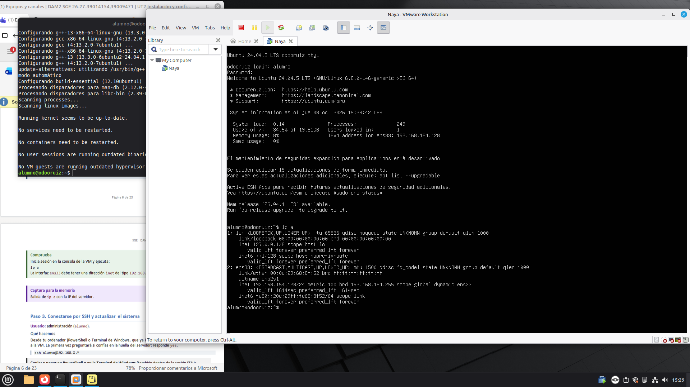
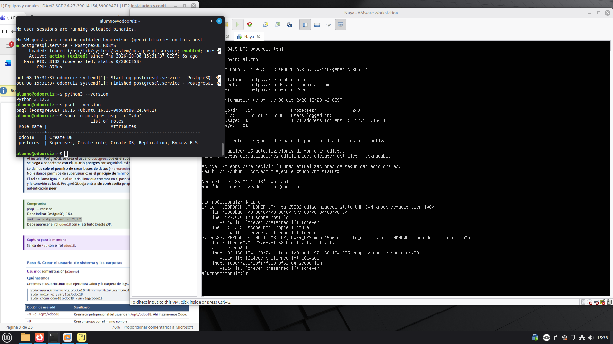
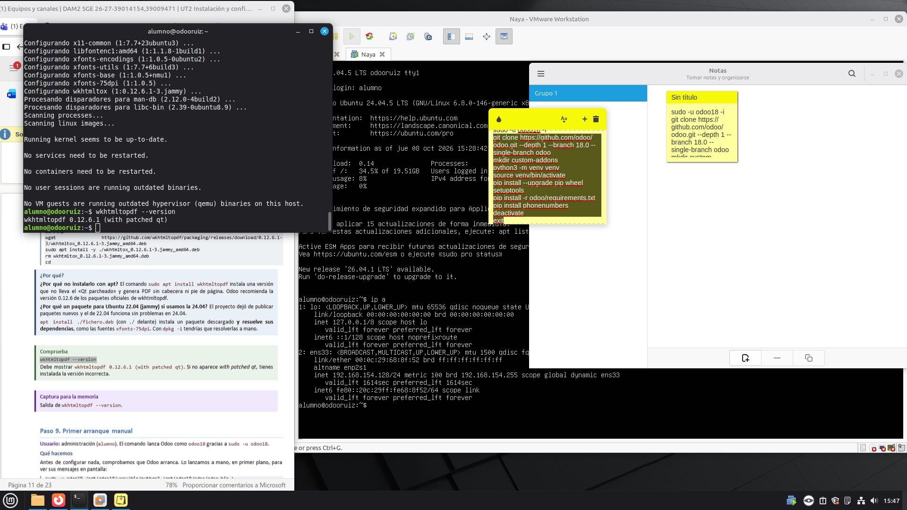
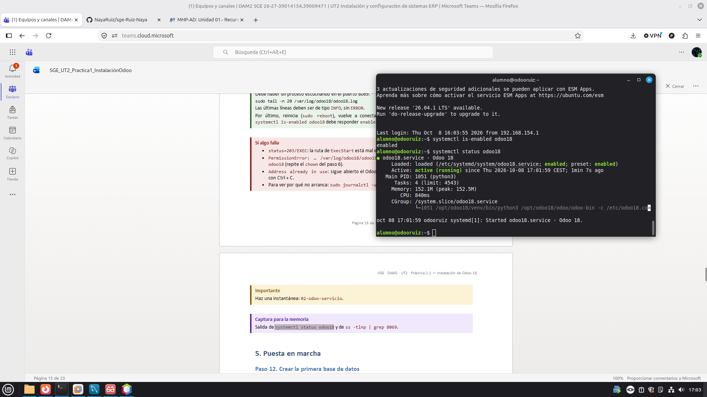
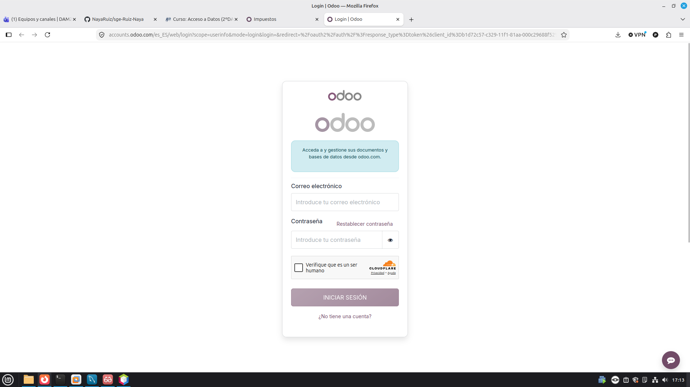
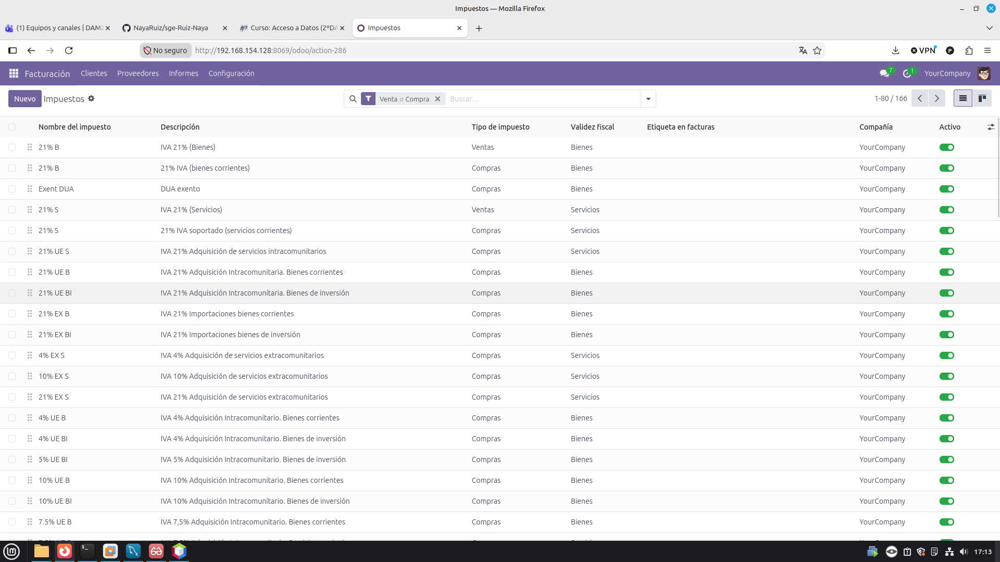
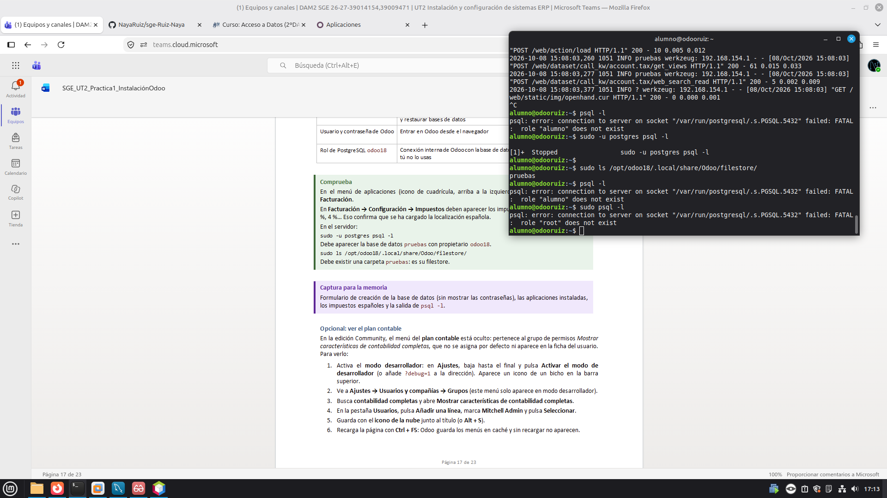

# UT2-Instalación Odoo
## Índice

- [1. Objetivo](#1-objetivo)
- [2. Datos de la instalación](#2-datos-de-la-instalación)
- [3. Estructura y rutas](#3-estructura-y-rutas)
- [4. Proceso de instalación](#4-proceso-de-instalación)
- [5. Configuración del servicio](#5-configuración-del-servicio)
- [6. Puesta en marcha de Odoo](#6-puesta-en-marcha-de-odoo)
- [7. Verificación](#7-verificación)
- [8. Copia de seguridad y restauración](#8-copia-de-seguridad-y-restauración)
- [9. Incidencias](#9-incidencias)
- [10. Conclusiones](#10-conclusiones)

## 1. Objetivo

El objetivo de esta práctica es instalar Odoo 18 Community desde el código fuente en una máquina virtual con Ubuntu Server 24.04 LTS. También se prepara PostgreSQL, se configura Odoo para ejecutarse como servicio, se crea una base de datos, se comprueba el funcionamiento de la aplicación y se realiza una copia de seguridad para probar su restauración.

## 2. Datos de la instalación

Completar los datos que dependan de la máquina real. No se deben inventar la IP ni el nombre del equipo.

| Elemento | Valor |
|---|---|
| Sistema operativo | Ubuntu Server 24.04 LTS |
| ERP | Odoo 18 Community |
| Python | 3.12 |
| PostgreSQL | 16 |
| Nombre de la máquina | `odoo-<ruiz>`|
| Usuario administrador de Linux | `alumno`|
| Usuario de sistema de Odoo | `odoo18` |
| Rol de PostgreSQL | `odoo18` |
| Base de datos principal | `pruebas` |
| Puerto web | `8069` |
| Dirección IP del servidor | Añadir la IP real que aparece en la captura `img/2_Paso2_ip_a.png` |

## 3. Estructura y rutas

La instalación separa el código de Odoo, las librerías de Python, la configuración y los datos.

| Elemento | Ruta | Función |
|---|---|---|
| Directorio de instalación | `/opt/odoo18` | Contiene los componentes de la instalación |
| Código de Odoo | `/opt/odoo18/odoo` | Código fuente y módulos oficiales |
| Entorno virtual de Python | `/opt/odoo18/venv` | Librerías de Python necesarias para Odoo |
| Módulos adicionales | `/opt/odoo18/custom-addons` | Módulos propios o de terceros |
| Configuración de Odoo | `/etc/odoo18.conf` | Parámetros de ejecución |
| Servicio systemd | `/etc/systemd/system/odoo18.service` | Define cómo inicia Linux Odoo |
| Registro (log) | `/var/log/odoo18/odoo18.log` | Guarda mensajes y errores |
| Base de datos | PostgreSQL | Guarda datos de negocio |
| Filestore | `/opt/odoo18/.local/share/Odoo/filestore` | Guarda adjuntos y ficheros asociados a Odoo |

## 4. Proceso de instalación

> Las capturas que se muestran aquí son las evidencias disponibles en la carpeta `img/`. Añade o cambia las referencias si alguna imagen no corresponde al paso indicado.

### 4.1. Preparación del servidor

Se crea una máquina virtual con Ubuntu Server 24.04 LTS y se actualizan los paquetes del sistema. La conexión a la máquina se puede realizar desde la terminal mediante SSH.

Comandos de referencia:

```bash
sudo apt update
sudo apt upgrade -y
```

Para consultar la IP de la máquina:

```bash
ip a
```

Captura de la IP:



### 4.2. Instalación de dependencias

Antes de instalar Odoo se preparan las herramientas y bibliotecas que necesita el sistema. Entre ellas se encuentran Python, las dependencias de compilación y las bibliotecas necesarias para conectar con PostgreSQL y otros servicios.

Los paquetes concretos deben corresponder a los comandos ejecutados durante la práctica. Si se ha guardado una captura de este paso, se puede añadir aquí.

### 4.3. Preparación de PostgreSQL

PostgreSQL es el sistema gestor de bases de datos utilizado por Odoo. Se crea el rol `odoo18` para que la aplicación pueda acceder a sus bases de datos sin ejecutarse con el superusuario `postgres`.

Para comprobar los roles se utiliza:

```bash
sudo -u postgres psql -c "\du"
```

Captura disponible:



### 4.4. Descarga del código y entorno virtual

El código fuente de Odoo 18 se sitúa en `/opt/odoo18/odoo`. Las dependencias de Python se instalan en un entorno virtual independiente ubicado en `/opt/odoo18/venv`. Esta separación evita mezclar las bibliotecas de Odoo con las del sistema operativo.

Las rutas de esta práctica son:

- Código fuente: `/opt/odoo18/odoo`
- Entorno virtual: `/opt/odoo18/venv`
- Módulos adicionales: `/opt/odoo18/custom-addons`

### 4.5. Instalación de wkhtmltopdf

`wkhtmltopdf` permite generar documentos PDF a partir de contenido HTML. Odoo lo utiliza para producir informes, presupuestos y facturas con formato.

La captura siguiente documenta la comprobación de su versión:



### 4.6. Configuración y arranque como servicio

Una vez instalado el código y sus dependencias, Odoo se configura para ejecutarse como un servicio de `systemd`. Esto permite consultar su estado y arrancarlo o reiniciarlo mediante `systemctl`.

La captura disponible muestra la comprobación del servicio:



## 5. Configuración del servicio

Los archivos de ejemplo de configuración se guardan en `config/` dentro de esta práctica. Son ejemplos documentales; no deben presentarse como una copia exacta de la configuración real si no se han comparado con los archivos del servidor.

- [`config/odoo18.conf.example`](config/odoo18.conf.example): plantilla de configuración de Odoo.
- [`config/odoo18.service`](config/odoo18.service): ejemplo del servicio `systemd`.

### 5.1. Parámetros principales de `odoo18.conf`

| Parámetro | Significado |
|---|---|
| `admin_passwd` | Contraseña maestra que protege operaciones administrativas sobre bases de datos. En el repositorio debe usarse un marcador, nunca la contraseña real. |
| `db_host` | Servidor PostgreSQL. `False` suele indicar conexión local mediante la configuración local de PostgreSQL. |
| `db_port` | Puerto de PostgreSQL; `False` utiliza el valor predeterminado. |
| `db_user` | Rol de PostgreSQL que utiliza Odoo. En esta práctica se plantea `odoo18`. |
| `db_password` | Contraseña del rol de PostgreSQL si se utiliza una. No publicar contraseñas reales. |
| `addons_path` | Rutas de los módulos oficiales y adicionales. |
| `logfile` | Ruta del archivo donde se guardan los registros de Odoo. |
| `http_port` | Puerto web de Odoo, configurado como `8069`. |

### 5.2. Parámetros principales de `odoo18.service`

| Parámetro | Significado |
|---|---|
| `After` | Indica que el servicio se inicia después de la red y PostgreSQL. |
| `User` y `Group` | Usuario y grupo de Linux con los que se ejecuta Odoo. |
| `WorkingDirectory` | Directorio de trabajo del proceso. |
| `ExecStart` | Comando que inicia Odoo con Python del entorno virtual y el archivo de configuración. |
| `Restart` | Indica cuándo debe intentar reiniciarse el servicio. |
| `WantedBy` | Permite habilitar el servicio para el arranque normal del sistema. |

## 6. Puesta en marcha de Odoo

Se accede desde el navegador a `http://IP_DEL_SERVIDOR:8069`, sustituyendo `IP_DEL_SERVIDOR` por la IP real de la máquina virtual.

Durante la práctica se crea la base de datos `pruebas` y se comprueba el acceso a las aplicaciones. Las capturas disponibles son:






La captura de impuestos españoles sirve como evidencia de la configuración de localización española, si en ella se ven los impuestos correspondientes.

## 7. Verificación

La siguiente tabla recoge las comprobaciones que se deben realizar. Completa la columna de resultado con lo que hayas observado realmente; no marques una prueba como correcta solo porque sea el resultado esperado.

| Comprobación | Comando o evidencia | Resultado |
|---|---|---|
| Servicio activo | `sudo systemctl status odoo18` | Pendiente de completar con el resultado real |
| Arranque automático | `sudo systemctl is-enabled odoo18` y reinicio de la VM | Pendiente de comprobar |
| Puerto 8069 escuchando | `sudo ss -tlnp \| grep 8069` | Pendiente de comprobar |
| Errores en el log | `sudo grep -E "ERROR\|CRITICAL" /var/log/odoo18/odoo18.log` | Pendiente de comprobar |
| Base de datos `pruebas` | `sudo -u postgres psql -l` | Consultar la salida real |
| Acceso desde el navegador | `http://IP_DEL_SERVIDOR:8069` | Comprobar que carga Odoo |
| Localización española | Menú de impuestos de Odoo | Véase `img/5_Paso12_impuestos_españoles.png` |
| Flujo de venta y factura | Presupuesto, confirmación y factura | Completar con la evidencia real |
| Generación de PDF | PDF de una factura | Existe el archivo `img/Pedido_de_venta_S00023.pdf`; comprobar su contenido |
| Filestore | `sudo ls /opt/odoo18/.local/share/Odoo/filestore/pruebas` | Pendiente de comprobar |

La captura `img/5_Paso12_psql_-l.png` puede utilizarse como evidencia del listado de bases de datos si muestra la salida correspondiente.



## 8. Copia de seguridad y restauración

La práctica contempla realizar una copia de la base de datos desde el gestor de bases de datos de Odoo en formato ZIP con el filestore incluido. El ZIP debe contener, entre otros elementos, `dump.sql`, la carpeta `filestore` y `manifest.json`.

El procedimiento indicado en la guía es:

1. Abrir el gestor de bases de datos de Odoo.
2. Seleccionar la base de datos `pruebas` y elegir la opción de copia de seguridad.
3. Seleccionar el formato ZIP incluyendo el filestore y descargarlo.
4. Restaurar la copia con el nombre `pruebas-restaurada`.
5. Marcar las opciones `Neutralize` y `This database is a copy`.
6. Entrar en la base restaurada y comprobar que conserva los datos y que se pueden descargar los documentos.

En la carpeta `img/` existe un archivo ZIP cuyo nombre comienza por `pruebas_2026-10-08_15-20-3...`. Comprueba su nombre completo en GitHub y que contiene los elementos anteriores antes de dar la copia por validada.

También está el PDF `img/Pedido_de_venta_S00023.pdf`, que puede servir como evidencia del documento generado. La existencia del ZIP por sí sola no demuestra que la restauración se haya completado correctamente: registra el resultado real de la prueba.

## 9. Incidencias

Las incidencias se documentan en [`incidencias.md`](incidencias.md).

## 10. Conclusiones

En esta práctica se trabaja con la instalación de Odoo desde código fuente y con los componentes que necesita para funcionar: Python y sus dependencias, PostgreSQL, el archivo de configuración y el servicio `systemd`. También se aprende que la base de datos y el filestore almacenan información diferente, por lo que una copia de seguridad completa debe tener en cuenta ambos.

Habiendo probado esta herramienta, concluyo que es una herramienta muy util para gestionar a nivel empresarial bases de datos, siempre y cuando, se tenga conocimientos en sistemas.
