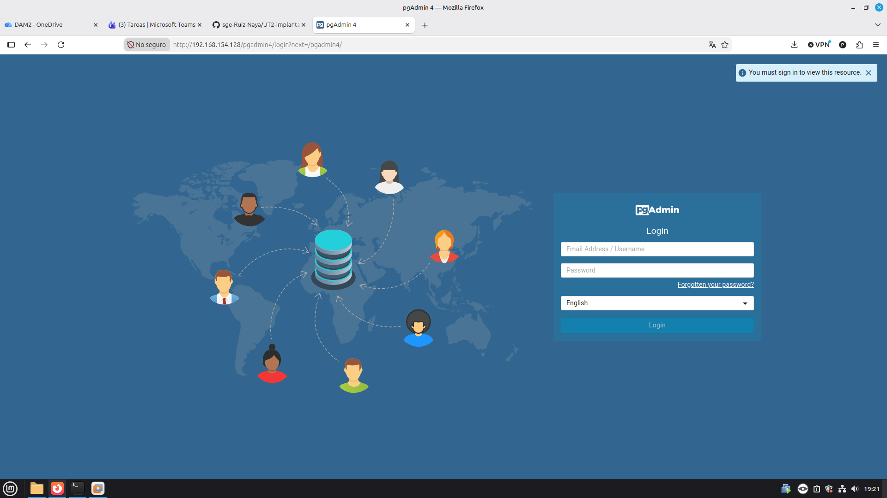
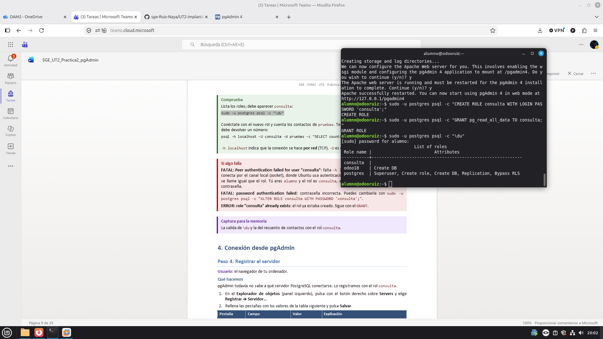
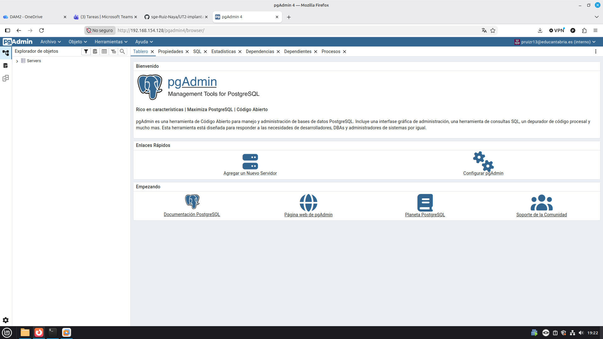
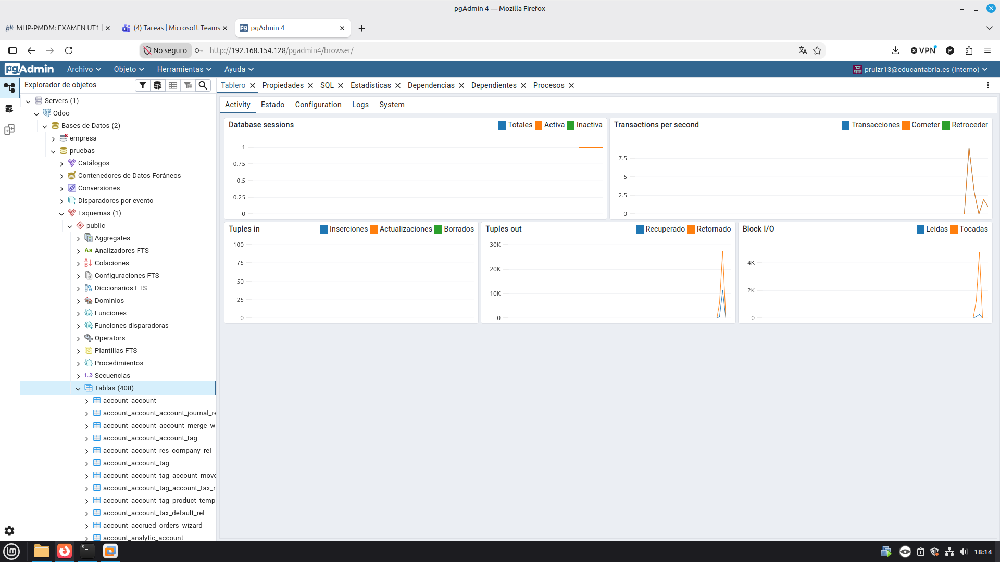
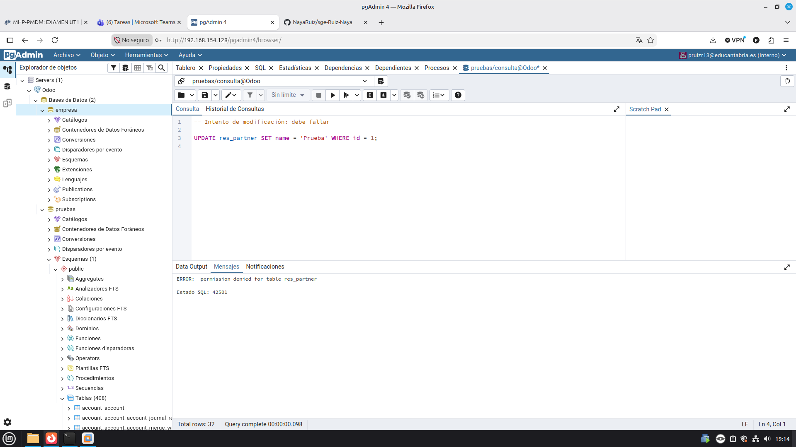
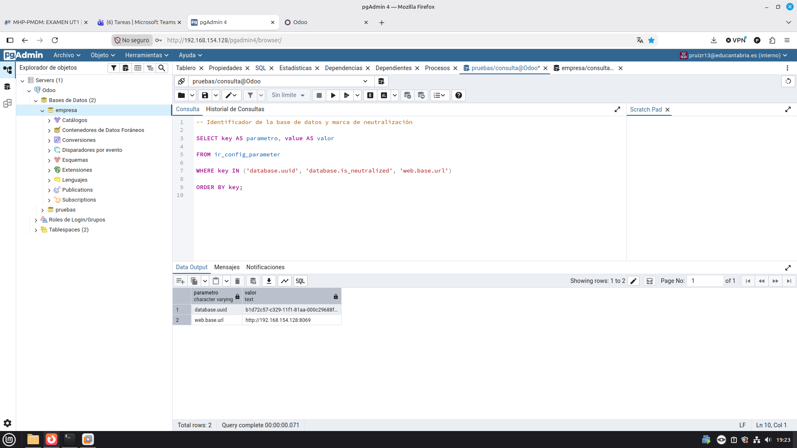

# UT2.2-Pgadmin
## Índice

- [1. Objetivo](#1-objetivo)
- [2. Datos de la práctica](#2-datos-de-la-práctica)
- [3. Estructura y rutas](#3-estructura-y-rutas)
- [4. Proceso de instalación y conexión](#4-proceso-de-instalación-y-conexión)
- [5. Exploración de la base de datos](#5-exploración-de-la-base-de-datos)
- [6. Verificación de la implantación](#6-verificación-de-la-implantación)
- [7. Diagramas entidad-relación](#7-diagramas-entidad-relación)
- [8. Preguntas de la memoria](#8-preguntas-de-la-memoria)
- [9. Incidencias](#9-incidencias)
- [10. Conclusiones](#10-conclusiones)

## 1. Objetivo

El objetivo de esta práctica es instalar pgAdmin 4 en modo web en la máquina virtual con Ubuntu Server 24.04 LTS donde ya funciona Odoo 18 (práctica 2.1) y utilizarlo para examinar las bases de datos de Odoo. Se crea un rol de PostgreSQL de solo lectura para conectarse con el mínimo privilegio necesario, se identifican los módulos instalados en cada base de datos, se comprueba que las bases de datos son independientes entre sí y se dibuja el modelo de datos con diagramas entidad-relación.

No es una práctica de SQL: las consultas sirven para comprobar con datos objetivos lo que se hizo en la práctica 2.1.

## 2. Datos de la práctica

Completar los datos que dependan de la máquina real. No se deben inventar la IP ni la versión.

| Elemento | Valor |
|---|---|
| Sistema operativo | Ubuntu Server 24.04 LTS |
| Herramienta | pgAdmin 4 en modo web (servido por Apache) |
| Versión de pgAdmin | Añadir la que aparece en *Ayuda → Acerca de pgAdmin 4* |
| Dirección de pgAdmin | `http://IP_DEL_SERVIDOR/pgadmin4` (sustituir por la IP real) |
| Cuenta de acceso a pgAdmin | Correo y contraseña elegidos en `setup-web.sh` (no se publican) |
| Rol de PostgreSQL para consultar | `consulta` (solo lectura) |
| Bases de datos de Odoo | `pruebas` (Ventas, con datos de demostración), `empresa` (CRM, sin datos de demostración) y `pruebas-restaurada` (copia de `pruebas`) |
| Puerto de pgAdmin / Apache | `80` |
| Puerto de PostgreSQL | `5432` (solo acceso local, no se abre al exterior) |

Hay tres cuentas distintas que no se deben confundir:

| Cuenta | Dónde vive | Para qué sirve |
|---|---|---|
| Cuenta de pgAdmin (correo) | Base de datos interna de pgAdmin | Entrar en la aplicación pgAdmin |
| Rol `consulta` | PostgreSQL | Conectar pgAdmin a las bases de datos de Odoo |
| Usuario de Odoo | Base de datos de Odoo | Entrar en Odoo desde el navegador |

## 3. Estructura y rutas

Se añade una pieza más a la arquitectura de la práctica 2.1. El cliente sigue siendo solo el navegador.

| Pieza | Función | Dónde está | Puerto |
|---|---|---|---|
| PostgreSQL | Guarda los datos de Odoo | Máquina virtual | 5432 (acceso local) |
| Servidor Odoo | ERP, accede con el rol `odoo18` | Máquina virtual | 8069 |
| pgAdmin 4 (modo web) | Administra y consulta PostgreSQL, servido por Apache | Máquina virtual | 80 |
| Cliente | Navegador para Odoo y pgAdmin | Ordenador anfitrión | — |

| Elemento | Ruta | Función |
|---|---|---|
| Repositorio de Apache de pgAdmin | `/etc/apt/sources.list.d/pgadmin4.list` | Indica a `apt` dónde están los paquetes de pgAdmin |
| Clave del repositorio | `/usr/share/keyrings/packages-pgadmin-org.gpg` | Verifica la autenticidad de los paquetes |
| Script de configuración | `/usr/pgadmin4/bin/setup-web.sh` | Crea la cuenta inicial y publica pgAdmin en Apache |
| Configuración de Apache | `/etc/apache2/conf-enabled/pgadmin4.conf` | Publica pgAdmin en la ruta `/pgadmin4` |
| Almacenamiento de pgAdmin | `/var/lib/pgadmin/storage/<correo>/` | Ficheros guardados desde pgAdmin (la `@` se sustituye por `_`) |
| Consultas de la práctica | `Consultas/p2_p/p2_2_consultas.sql` | Fichero SQL comentado descargado de pgAdmin |

Estructura de esta práctica en el repositorio:

```text
UT2.2-pgadmin/
├── README.md              ← memoria de la práctica
├── incidencias.md         ← registro de incidencias
├── Consultas/
│   └── p2_p/
│       └── p2_2_consultas.sql
└── img/                   ← capturas y diagramas
```

## 4. Proceso de instalación y conexión

> Las capturas que se muestran aquí son las evidencias disponibles en la carpeta `img/`.

### 4.1. Repositorio oficial de pgAdmin (Paso 1)

pgAdmin 4 no está en los repositorios de Ubuntu, por lo que hay que añadir el repositorio que publica el propio proyecto y la clave con la que `apt` comprueba que los paquetes son auténticos. Es un tipo de instalación distinto al de Odoo: aquí se instala un paquete ya preparado, que además se actualiza con `apt upgrade`.

```bash
curl -fsS https://www.pgadmin.org/static/packages_pgadmin_org.pub | sudo gpg --dearmor -o /usr/share/keyrings/packages-pgadmin-org.gpg

sudo sh -c 'echo "deb [signed-by=/usr/share/keyrings/packages-pgadmin-org.gpg] https://ftp.postgresql.org/pub/pgadmin/pgadmin4/apt/$(lsb_release -cs) pgadmin4 main" > /etc/apt/sources.list.d/pgadmin4.list'

sudo apt update
```

Comprobación: `apt update` muestra la dirección `ftp.postgresql.org/pub/pgadmin/pgadmin4/apt/noble` sin errores y `apt policy pgadmin4-web` indica una versión candidata.

### 4.2. Instalación de pgAdmin en modo web (Paso 2)

Se instala la versión web y se ejecuta su script de configuración, que crea la base de datos interna de pgAdmin, la primera cuenta de acceso, publica pgAdmin en Apache en la ruta `/pgadmin4` y reinicia Apache.

```bash
sudo apt install -y pgadmin4-web
sudo /usr/pgadmin4/bin/setup-web.sh
```

Se elige el modo web frente al de escritorio porque se instala una sola vez en el servidor y se usa desde cualquier navegador, igual que Odoo, sin instalar nada en el ordenador del cliente.

Captura de la pantalla principal de pgAdmin tras iniciar sesión:



### 4.3. Rol de solo lectura (Paso 3)

Se crea el rol `consulta`, que puede leer todas las tablas pero no modificar nada. Es el rol que usará pgAdmin para conectarse.

```bash
sudo -u postgres psql -c "CREATE ROLE consulta WITH LOGIN PASSWORD '<contraseña>';"
sudo -u postgres psql -c "GRANT pg_read_all_data TO consulta;"
```

Se aplica el **principio de mínimo privilegio**: para consultar basta con leer. `odoo18` es el propietario de las bases de datos y `postgres` es el superusuario del servidor, por lo que un error con cualquiera de ellos podría estropear Odoo. Además, en Odoo los datos se modifican desde Odoo y nunca directamente en las tablas, porque una modificación manual se salta las reglas de la aplicación (totales, permisos, restricciones, relaciones) y deja datos incoherentes.

Comprobación de los roles:

```bash
sudo -u postgres psql -c "\du"
```



### 4.4. Registro del servidor en pgAdmin (Paso 4)

Desde el navegador se registra el servidor (*Servers → Registrar → Servidor…*) con estos valores:

| Pestaña | Campo | Valor |
|---|---|---|
| General | Nombre | `Odoo` |
| Conexión | Servidor | `localhost` |
| Conexión | Puerto | `5432` |
| Conexión | Base de datos de mantenimiento | `postgres` |
| Conexión | Usuario | `consulta` |
| Conexión | Contraseña | La del rol (activando *Salvar contraseña*) |

Para que solo aparezcan las bases de datos de Odoo se configura la **restricción DB** (pestaña *Avanzado*) con el servidor desconectado, añadiendo `empresa`, `pruebas` y `pruebas-restaurada` como etiquetas separadas, cada una con Enter.

En PostgreSQL cada base de datos contiene esquemas y dentro de ellos están las tablas. Odoo guarda todo en el esquema `public`. Además, no existe `USE`: cada editor de consultas queda unido a la base de datos desde la que se abrió.

Capturas del Explorador de objetos con las tres bases de datos y el número de tablas:





## 5. Exploración de la base de datos

Las consultas se ejecutan en el Query Tool de pgAdmin con el rol `consulta` y están reunidas, con un comentario explicativo antes de cada una, en [`Consultas/p2_p/p2_2_consultas.sql`](Consultas/p2_p/p2_2_consultas.sql).

| Nº | Tabla(s) principal(es) | Qué comprueba |
|---|---|---|
| 1 | `res_partner` | Lista los contactos (clientes, proveedores, empresas y personas) |
| 2 | `res_users` + `res_partner` | Usuarios de Odoo y su nombre, que está en el contacto asociado (clave foránea `partner_id`) |
| 3 | `product_template` | Productos y sus campos traducibles, guardados en JSON (`name->>'es_ES'`) |
| 4 | `ir_module_module` | Módulos instalados y cuáles son aplicaciones |
| 5 | `ir_module_module` | Número de módulos por estado (`installed`, `uninstalled`…) |
| 6 | `information_schema.tables` | Número de tablas del esquema `public` |
| 7 | `ir_model_data` | Módulos que definen o amplían más modelos |
| 8 | `ir_model` + `ir_model_data` | Modelos de un módulo (`sale` o `crm`) y su tabla (`sale.order` → `sale_order`) |
| 9 | `res_partner`, `res_users`, `ir_module_module` | Resumen de contactos, usuarios y módulos de una base de datos |
| 10 | `account_move` | Últimas facturas de cliente (`move_type = 'out_invoice'`) |
| 11 | `ir_config_parameter` | `database.uuid`, `database.is_neutralized` y `web.base.url` |
| 12 | `ir_cron` | Acciones planificadas activas e inactivas |

Observaciones:

- Cada modelo de Odoo (`res.partner`) se guarda en una tabla con el mismo nombre cambiando los puntos por guiones bajos (`res_partner`).
- La consulta 3 funciona en `pruebas` y falla en `empresa` con el error `relation "product_template" does not exist` (código `42P01`). No es un fallo de la instalación: en `empresa` no está instalado el módulo que crea esa tabla.
- Los módulos con estado `uninstalled` tienen su código en el servidor pero no están activados en esa base de datos. Instalar un módulo es activarlo en **una** base de datos concreta.

## 6. Verificación de la implantación

### 6.1. Módulos y tablas por base de datos (Paso 6)

Resultados de las consultas 4, 5, 6 y 8 en cada base de datos:

| Dato | Pruebas | Empresa |
|------|---------|---------|
| Aplicaciones instaladas (consulta 4, es_aplicacion = true) | 3 | 6 |
| Módulos instalados en total (consulta 5) | 63 | 72 |
| Módulos disponibles sin instalar (consulta 5) | 589 | 580 |
| Número de tablas (consulta 6) | 480 | 449 |
| Tres tablas que solo existen en esta base de datos (consulta 8) | 32 | 22 |

Estos valores demuestran que dos bases de datos del mismo servidor y con el mismo código de Odoo pueden tener estructuras muy distintas: al instalar un módulo, Odoo crea sus tablas y añade columnas a las de los módulos que amplía.

### 6.2. El rol `consulta` solo puede leer (Paso 7)

Una verificación no se da por buena hasta que se prueba que falla lo que debe fallar. Con el rol `consulta` conectado a `pruebas` se intenta modificar un contacto:

```sql
UPDATE res_partner SET name = 'Prueba' WHERE id = 1;
```

PostgreSQL rechaza la sentencia con `ERROR: permission denied for table res_partner` (estado SQL `42501`, privilegios insuficientes), lo que demuestra que el rol no puede modificar los datos de Odoo.



### 6.3. Independencia de las bases de datos (Paso 8)

Resultados de las consultas 9 a 12 en `pruebas` y en `empresa`:

| Comprobación | Pruebas | Empresas | ¿Coincide? ¿Por qué? |
|--------------|---------|----------|----------------------|
| Contactos/ usuarios/ módulos (consulta 9) | 47/7/63 | 7/5/72 | No coincide. Porque son tablas que tratan cosas completamente diferentes |
| Factura de la práctica 2.1 (consulta 10) | 4 | 0 | No coincide. Porque son tablas que tratan cosas completamente diferentes |
| database.uuid (consulta 11) | b1d72c57-c329-11f1-81-aa-000c29688f | 1531150f-c7f2-11f1-9d61-000c29688f | No coincide. Porque son tablas que tratan cosas completamente diferentes |
| database.is_neutralized (consulta 11) | X | X | No aparece |
| Acciones planificadas activas (consulta 12) | 24 | 26 | No coincide. Porque son tablas que tratan cosas completamente diferentes |

> **Nota:** la guía plantea esta misma comparativa entre `pruebas` y `pruebas-restaurada`. Si se dispone de las capturas de `pruebas-restaurada`, añadir aquí una tercera columna con sus valores reales (en esa base de datos se espera un `database.uuid` distinto, la marca `database.is_neutralized` y menos acciones planificadas activas).

Capturas de la consulta 11:




## 7. Diagramas entidad-relación

Se generan con la opción *ERD For Table* de pgAdmin sobre una sola tabla y las que se relacionan con ella. No se genera el diagrama de la base de datos completa porque tiene cientos de tablas y no se puede leer.

Cada línea entre dos tablas es una relación: une una clave foránea (por ejemplo, `sale_order.partner_id`) con la clave primaria de otra tabla (`res_partner.id`). El extremo con varias ramas indica el lado «muchos».

**Tabla `crm_lead` en `empresa`** (oportunidades y *leads* del CRM):


**Tabla `sale_order` en `pruebas`** (pedidos de venta):


Interpretación del diagrama de `sale_order`:

| Clave foránea | Tabla relacionada | Qué representa en el proceso de venta |
|---|---|---|
| `partner_id` | `res_partner` | El cliente al que se le hace el pedido |
| `user_id` | `res_users` | El comercial o vendedor responsable del pedido |
| `company_id` | `res_company` | La empresa que emite el pedido |

Un pedido se relaciona con sus líneas mediante `sale_order_line`, que guarda en `order_id` el identificador del pedido: es una relación de uno a muchos, ya que un pedido tiene varias líneas y cada línea pertenece a un solo pedido.

## 8. Preguntas de la memoria

**1. ¿Por qué la consulta de productos funciona en `pruebas` y falla en `empresa`?**
Porque la tabla `product_template` la crea el módulo de productos, que solo está instalado en `pruebas` (por Ventas). En `empresa` solo se instaló CRM y sus dependencias, así que la tabla no existe y PostgreSQL devuelve el error `42P01`. El código de Odoo es el mismo para todas las bases de datos, pero las tablas solo se crean al instalar el módulo en cada una.

**2. ¿Por qué `empresa` tiene menos tablas que `pruebas`, si las dos están en el mismo servidor y con el mismo código de Odoo?**
Porque el número de tablas depende de los módulos instalados en cada base de datos y no del código disponible en el servidor. `pruebas` tiene 480 tablas y `empresa` 449, y cada una tiene tablas que la otra no tiene (32 y 22 respectivamente). `empresa` tiene más módulos en total, pero lo que cuenta es cuáles son: Ventas y las aplicaciones que arrastra crean más tablas que CRM.

**3. ¿Por qué aparecen módulos instalados que no activé (por ejemplo, `base`, `web` o `mail`)?**
Porque son dependencias. Al instalar una aplicación, Odoo instala automáticamente los módulos de los que depende. `base` es el núcleo del sistema, `web` es la interfaz web y `mail` aporta mensajería y seguimiento. Por eso hay 63 y 72 módulos instalados aunque solo se activaron unas pocas aplicaciones.

**4. ¿Por qué el `database.uuid` de `pruebas` y el de la base de datos restaurada son distintos?**
Porque al restaurar la copia con la opción *This database is a copy* Odoo genera un identificador nuevo. Así, los servicios externos (suscripciones, mensajería) no confunden la copia con la original. En las capturas, `pruebas` y `empresa` también tienen identificadores distintos, porque cada base de datos genera el suyo al crearse.

**5. ¿Qué indica `database.is_neutralized` y por qué cambia el número de acciones planificadas activas? ¿Neutralizaría una copia restaurada para recuperar la empresa tras una avería?**
Indica que la base de datos se ha neutralizado: Odoo desactiva los servidores de correo y las acciones planificadas (salvo la de limpieza interna) y añade esa marca. Por eso baja el número de acciones activas. No neutralizaría una copia restaurada para recuperar la empresa tras una avería, porque la copia debe funcionar como la original: necesita enviar correos a clientes reales y ejecutar sus tareas automáticas. Neutralizar sirve para entornos de prueba, no para producción.

**6. Relaciones de `sale_order` a través de `partner_id`, `user_id` y `company_id`, y relación con `sale_order_line`.**
Véase la tabla de interpretación de la sección 7: `partner_id` apunta al cliente (`res_partner`), `user_id` al vendedor (`res_users`) y `company_id` a la empresa (`res_company`). Las líneas del pedido están en `sale_order_line`, que se une al pedido mediante `order_id` (un pedido, muchas líneas).

## 9. Incidencias

Las incidencias se documentan en [`incidencias.md`](incidencias.md). Debe incluirse cada problema que haya aparecido, el paso en el que ocurrió, el mensaje de error, la causa identificada y la solución aplicada. No se añaden incidencias que no se hayan experimentado.

Formato utilizado:

| Nº | Fecha | Paso | Síntoma (mensaje de error) | Causa | Solución |
|---|---|---|---|---|---|
| 1 | DD/MM | Paso correspondiente | Mensaje real | Causa identificada | Solución aplicada |

Los errores `42P01` (consulta de productos en `empresa`) y `42501` (modificación con el rol `consulta`) no son incidencias: son resultados esperados y están documentados en las secciones 5 y 6.2.

## 10. Conclusiones

En esta práctica se ha visto cómo guarda Odoo la información: cada modelo es una tabla (`res.partner` → `res_partner`), los datos comunes no se duplican y se enlazan con claves foráneas (un usuario apunta a su contacto), y los campos traducibles se guardan en JSON con una clave por idioma. También se ha comprobado que la lista de módulos y su estado están en la propia base de datos (`ir_module_module`), por lo que dos bases de datos del mismo servidor pueden tener estructuras muy distintas según lo instalado en cada una.

pgAdmin resulta útil con un ERP para identificar qué módulos tiene una implantación que no se ha instalado uno mismo, verificar con evidencias que una copia de seguridad contiene lo esperado y entender el modelo de datos con diagramas. Trabajar con un rol de solo lectura permite hacerlo sin riesgo de dañar los datos de Odoo.

Para cerrar la memoria, añadir una conclusión personal indicando qué paso resultó más difícil, qué incidencia se resolvió y qué se mejoraría en una instalación destinada a una empresa real (por ejemplo, proteger pgAdmin con HTTPS y no dejar contraseñas simples en los roles).

---

**Nota:** las capturas incluidas en este README utilizan los nombres que aparecen en el repositorio. No se han subido contraseñas al repositorio.
