# UT3.1 – Puesta en marcha de InfoTaller

## Índice
- [1. Objetivo](#1-objetivo)
- [2. Preparación y base de datos](#2-preparación-y-base-de-datos)
- [3. Aplicaciones instaladas](#3-aplicaciones-instaladas)
- [4. Datos de la compañía](#4-datos-de-la-compañía)
- [5. Usuarios y permisos](#5-usuarios-y-permisos)
- [6. Comprobación de acceso](#6-comprobación-de-acceso)
- [7. Ampliación](#7-ampliación)
- [8. Incidencias](#8-incidencias)
- [9. Conclusiones](#9-conclusiones)

## 1. Objetivo

Poner en marcha InfoTaller en Odoo creando una base de datos sin datos de demostración, configurar la compañía, instalar las aplicaciones necesarias y crear los usuarios de la empresa con permisos adecuados a su puesto. Se comprueba qué aplicaciones ve cada usuario y se aplica el principio de mínimo privilegio: cada empleado dispone únicamente de los permisos necesarios.

## 2. Preparación y base de datos

Se utiliza el servidor Odoo de la UT2. Desde el gestor de bases de datos (`http://IP:8069/web/database/manager`) se crea una base de datos nueva con el nombre `infotaller_xyz`, sustituyendo `xyz` por las iniciales propias en minúsculas y sin tildes.

Configuración indicada en el enunciado:

| Campo | Valor |
|---|---|
| Nombre de base de datos | `infotaller_xyz` (adaptar a las iniciales) |
| Idioma | Spanish / Español |
| País | Spain |
| Datos de demostración | Desactivados |
| Usuario y contraseña iniciales | Administrador técnico (no publicar la contraseña) |

La base de datos de la práctica de instalación de UT2 no se reutiliza.

## 3. Aplicaciones instaladas

Se instalan las aplicaciones requeridas para trabajar en InfoTaller:

- Ventas
- Inventario
- Compra
- Facturación
- Reparaciones

Al instalar módulos, Odoo también puede instalar módulos adicionales por dependencias. La captura de aplicaciones instaladas permite documentar el resultado; la pestaña Datos técnicos de Reparaciones permite consultar sus dependencias.

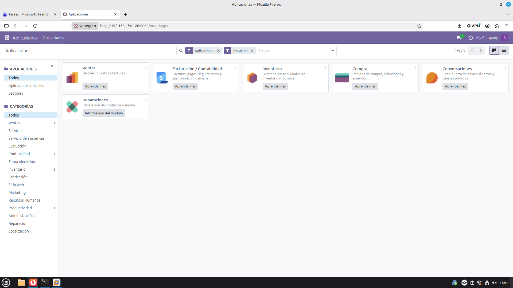

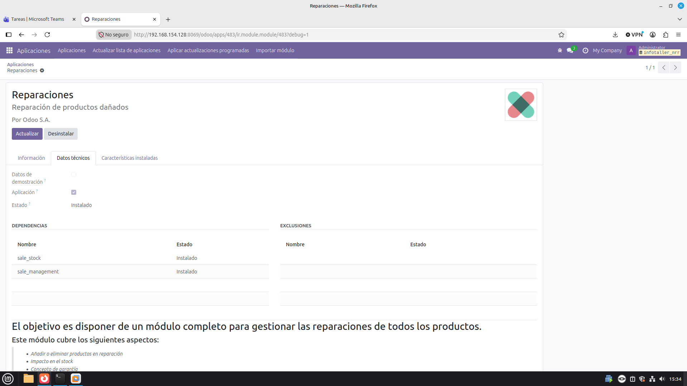

La localización española (`l10n_es`) se comprueba en Aplicaciones o revisando los impuestos desde Facturación → Configuración → Impuestos.

## 4. Datos de la compañía

En Ajustes → Ajustes generales → Compañías se actualiza la información de la empresa:

- Nombre: InfoTaller XYZ S.L. (con las iniciales correspondientes).
- NIF: B39123450.
- Dirección en Cantabria, teléfono, correo y página web.
- Logo de la empresa.

En la configuración del diseño de documentos se elige una plantilla, colores y pie de página para que los documentos comerciales se identifiquen con la compañía.

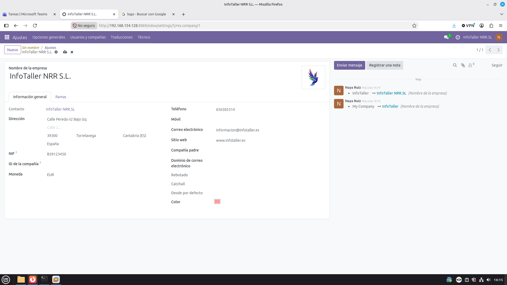

También se renombra el almacén desde Inventario → Configuración → Almacenes: nombre `InfoTaller` y abreviatura `WH`, para que las operaciones no aparezcan con el nombre predeterminado de la compañía.

## 5. Usuarios y permisos

Antes de crear usuarios se activa el modo desarrollador y se ajusta la plantilla de usuario. En Ajustes → Ajustes generales → Permisos se activa **Permisos de acceso por defecto** y se abre la plantilla. En los niveles de las aplicaciones se deja la opción vacía y se desmarca **Creación de productos**. De esta manera, los usuarios nuevos no heredan permisos administrativos innecesarios.

El administrador técnico mantiene su usuario de administración y se le identifica con el nombre propio seguido de “(técnico)”. Los usuarios de la empresa se crean desde cero, no duplicando otros usuarios, y se asignan sus permisos según el enunciado.

| Usuario | Correo | Puesto | Permisos asignados |
|---|---|---|---|
| Marta Ruiz | `marta@infotaller.es` | Gerente | Administrador en Ventas, Inventario, Compra y Contabilidad; sin Ajustes |
| Javier Gómez | `javier@infotaller.es` | Administrativo | Ventas: Usuario (todos los documentos); Compra: Usuario; Contabilidad: Facturación; Inventario: Usuario; Creación de productos |
| Lucía Fernández | `lucia@infotaller.es` | Técnica / jefa de taller | Inventario: Usuario |
| Daniel Ortiz | `daniel@infotaller.es` | Técnico | Inventario: Usuario |

Los cuatro son usuarios internos y tienen el idioma Spanish / Español en Preferencias. Reparaciones no tiene grupos específicos: se accede mediante el grupo Inventario / Usuario.

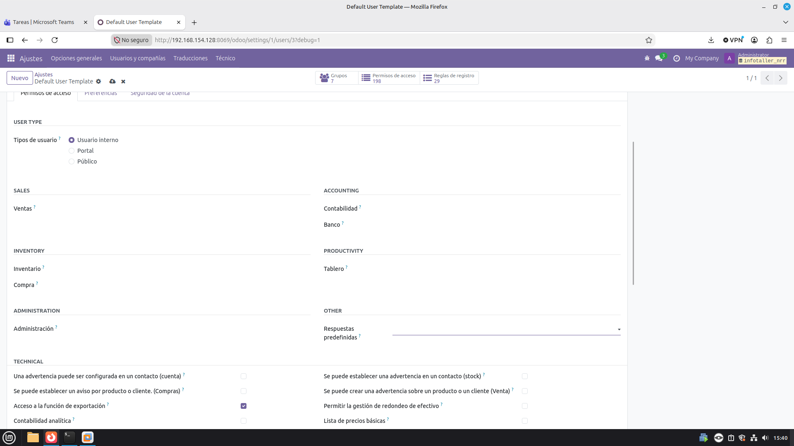
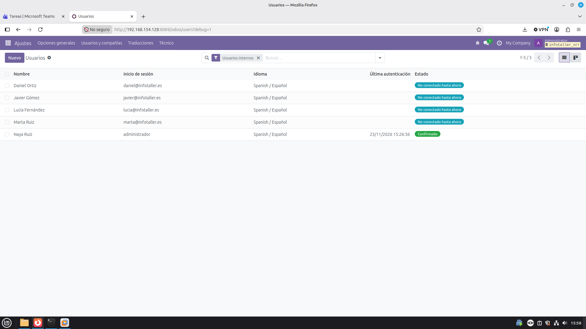

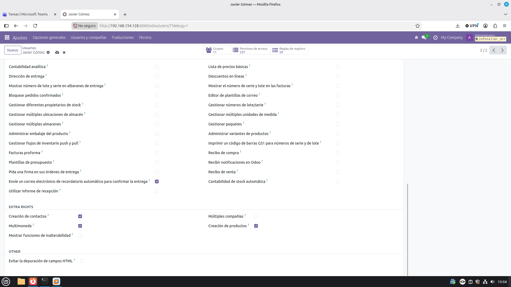
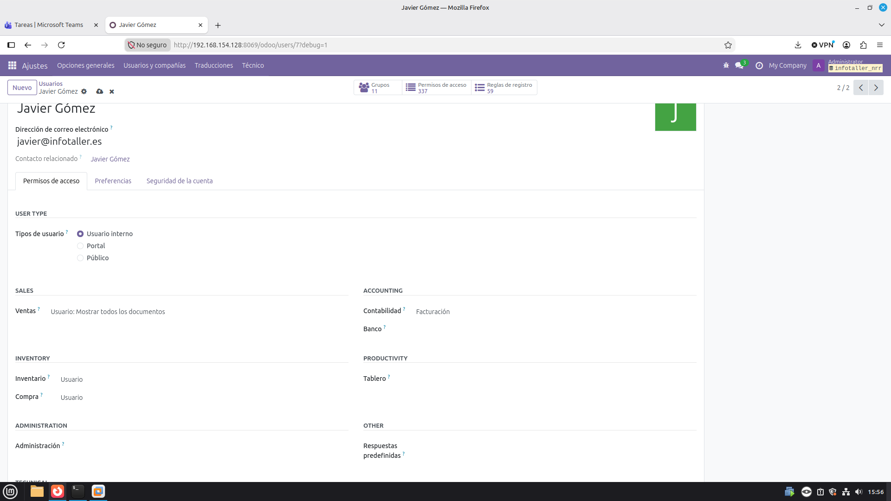
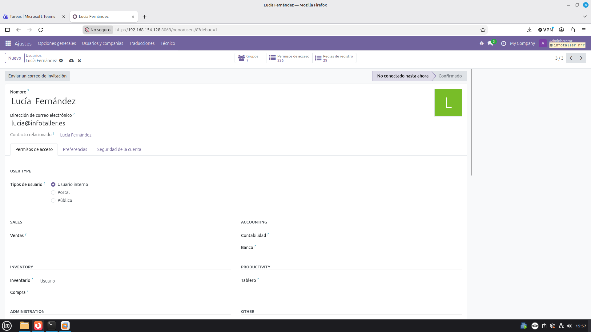
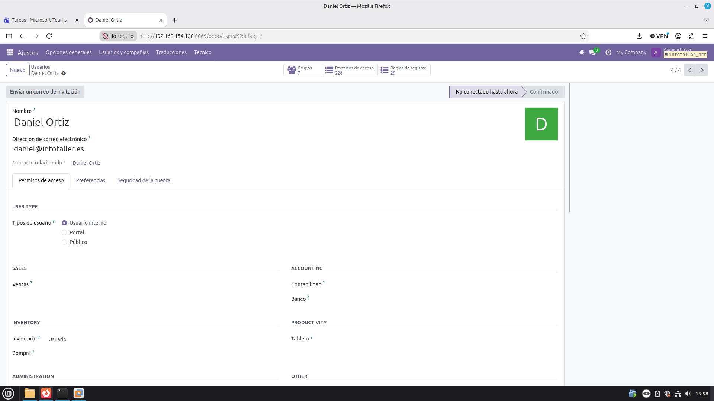

La captura de grupos y permisos sirve para comprobar también los permisos heredados. Marta, aunque es gerente, no recibe Ajustes.

## 6. Comprobación de acceso

Se comprueba la pantalla de inicio en sesiones privadas, cerrando la sesión entre usuarios:

| Usuario | Aplicaciones esperadas | Explicación |
|---|---|---|
| Marta | Ventas, Inventario, Compra, Facturación y Reparaciones | Tiene permisos de administración de esas aplicaciones, pero no Ajustes. |
| Javier | Ventas, Inventario, Compra, Facturación y Reparaciones | Tiene permisos de usuario en las aplicaciones asignadas. Reparaciones utiliza el grupo Inventario / Usuario. |
| Daniel | Inventario y Reparaciones | Solo tiene el grupo Inventario / Usuario. |

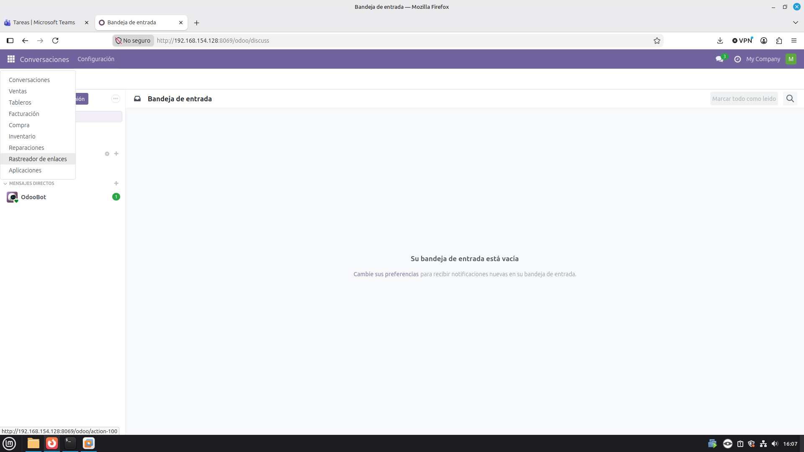
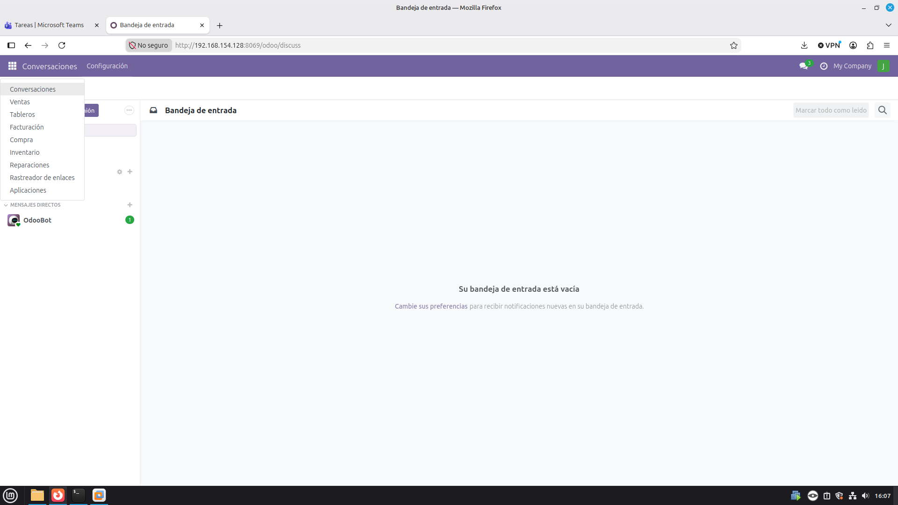
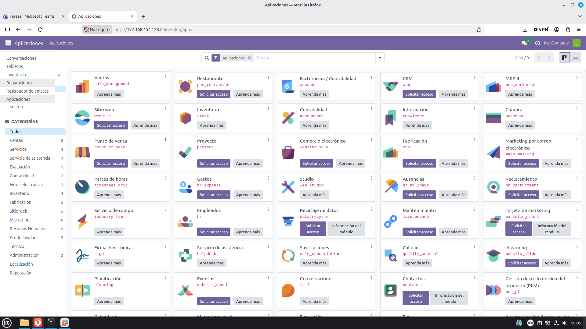
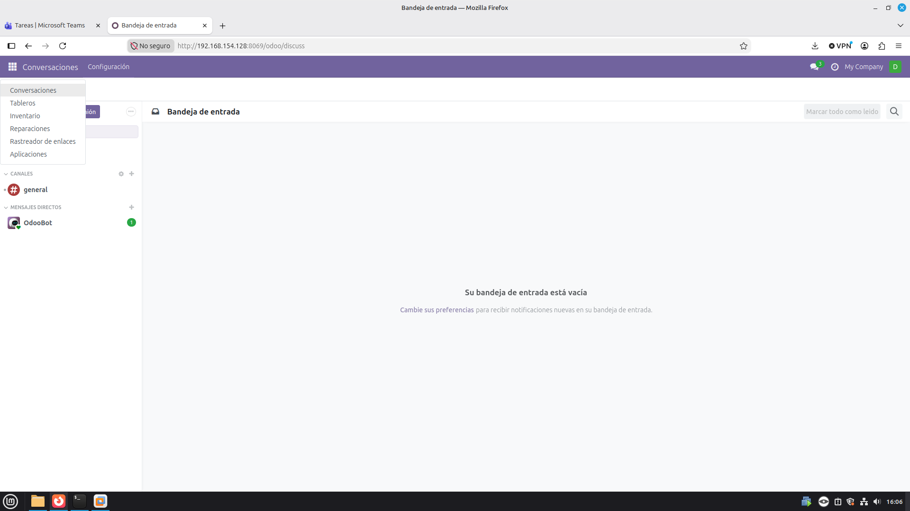

## 7. Ampliación

### Usuario Portal

Un usuario Portal es externo y está pensado para acceder a información que la empresa comparte con él, por ejemplo documentos o pedidos propios. No tiene los mismos permisos de trabajo internos que los empleados y no se le asignan grupos de administración de aplicaciones como a un usuario interno.

### Cambiar el nombre de una base de datos

Se puede duplicar la base desde el gestor de bases de datos y eliminar la anterior, o hacerlo en PostgreSQL. Si se cambia el nombre desde el servidor, también hay que conservar o renombrar correctamente el filestore asociado. Sin el filestore, pueden faltar adjuntos y documentos almacenados aunque los registros de la base de datos sigan existiendo.

### Gerente con permisos de Ajustes frente a técnico

Dar Ajustes al gerente puede facilitar la gestión si tiene conocimientos, pero aumenta el riesgo de cambios accidentales en configuración y permisos. Un técnico separado permite aplicar mínimo privilegio y mantener más clara la trazabilidad de los cambios administrativos.

## 8. Incidencias

Las incidencias reales se registran en [`incidencias.md`](incidencias.md), indicando síntoma, causa y solución. No se inventan incidencias si no se han producido.

## 9. Conclusiones

La configuración inicial de un ERP debe separar la administración técnica del trabajo diario. Crear usuarios desde una plantilla sin permisos y asignar únicamente los grupos necesarios reduce riesgos y permite comprobar de forma controlada qué puede hacer cada empleado.
