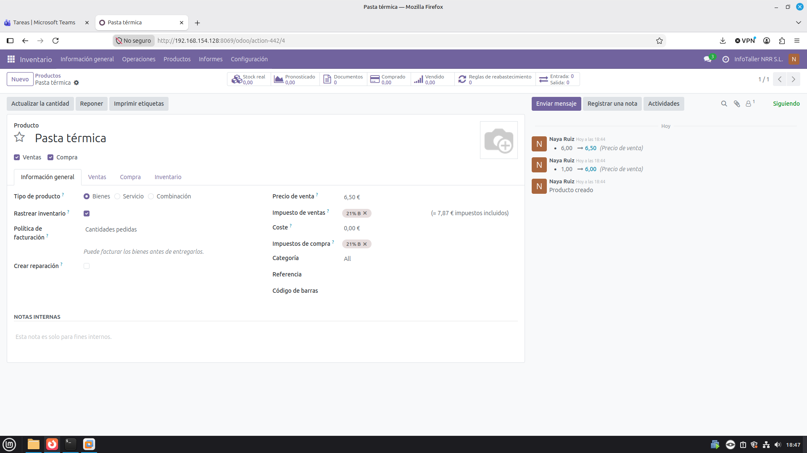
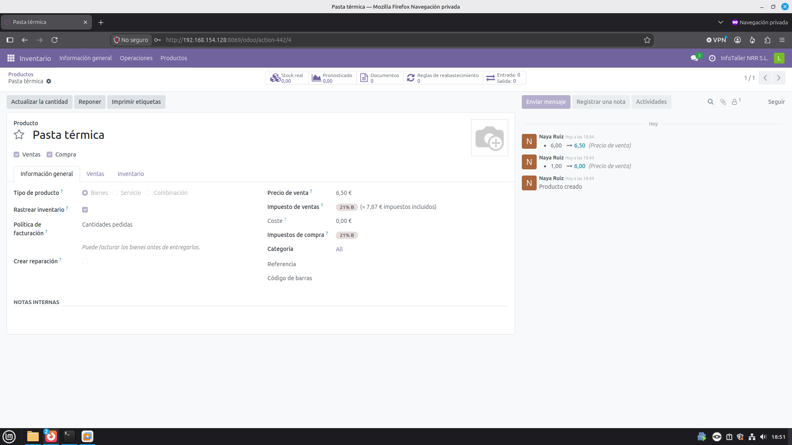
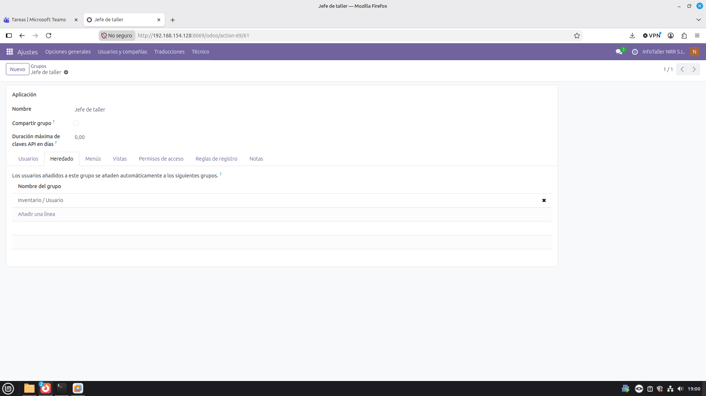
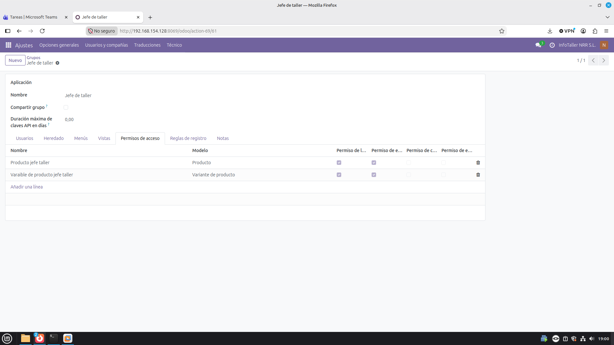
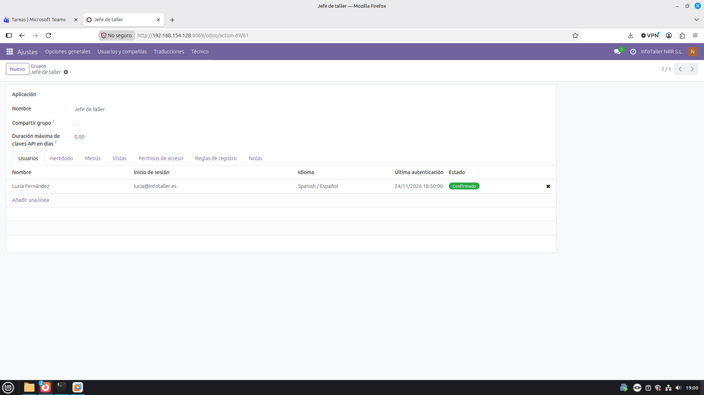
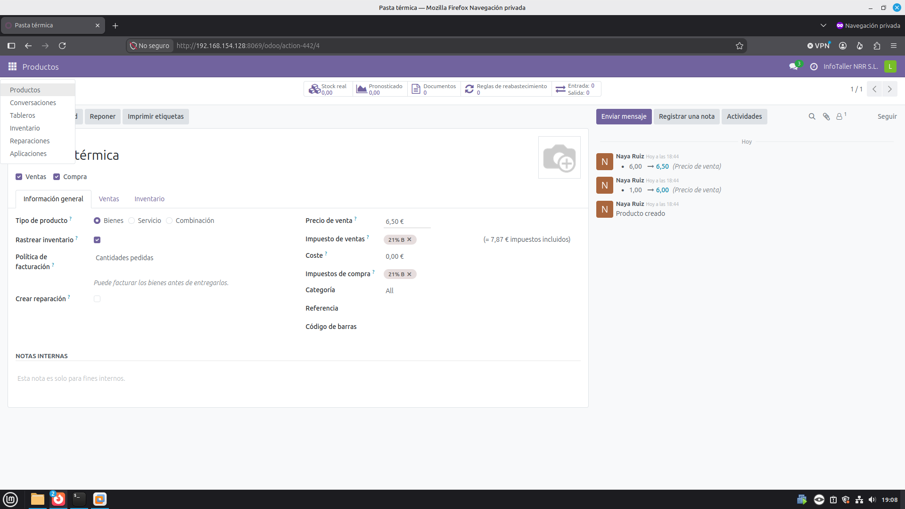
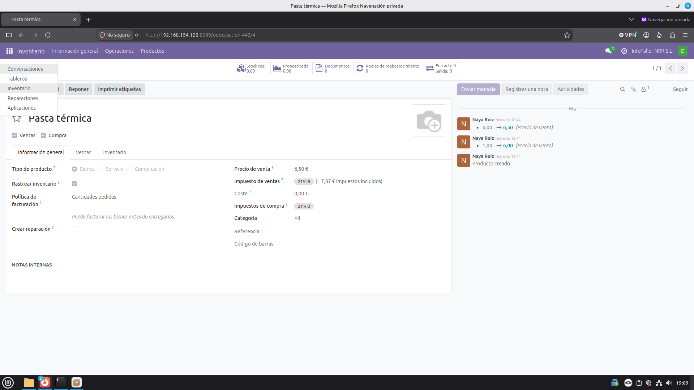

# UT3.2 – Un grupo y un menú a medida

## Índice
- [1. Objetivo](#1-objetivo)
- [2. Punto de partida](#2-punto-de-partida)
- [3. Creación del grupo Jefe de taller](#3-creación-del-grupo-jefe-de-taller)
- [4. Menú de acceso directo](#4-menú-de-acceso-directo)
- [5. Comprobaciones](#5-comprobaciones)
- [6. Ampliación](#6-ampliación)
- [7. Incidencias](#7-incidencias)
- [8. Conclusiones](#8-conclusiones)

## 1. Objetivo

Consultar los permisos efectivos de un usuario y un grupo estándar, crear un grupo propio que herede los permisos de Inventario / Usuario y añadir únicamente los permisos de escritura necesarios para que Lucía pueda actualizar precios de productos. Se crea además un menú visible solo para miembros del nuevo grupo y se comprueba el resultado con Lucía y Daniel.

## 2. Punto de partida

Se crea en Inventario un producto de prueba llamado **Pasta térmica**, de tipo Bienes y con precio de venta 6,50 €. Se entra con Lucía y se intenta cambiar el precio. La prueba inicial sirve para comprobar que el usuario Inventario / Usuario no dispone por sí solo del permiso de escritura requerido.

El permiso del modelo `product.template` del grupo Inventario / Usuario permite consultar el producto, pero no modificarlo. Por ello, Lucía necesita un permiso adicional específico, sin concederle permisos generales de creación de productos.

## 3. Creación del grupo Jefe de taller

Desde Ajustes → Usuarios y compañías → Grupos → Nuevo se crea el grupo **Jefe de taller**, dejando Aplicación vacío.

### Herencia

Se añade como grupo heredado **Inventario / Usuario**. Así Lucía conserva el acceso a Inventario y Reparaciones que ya tenía como técnica.

### Permisos de acceso

Se añaden permisos de lectura y escritura, sin creación ni eliminación, para estos modelos:

| Modelo | Leer | Escribir | Crear | Eliminar |
|---|---:|---:|---:|---:|
| Producto (`product.template`) | Sí | Sí | No | No |
| Variante de producto (`product.product`) | Sí | Sí | No | No |

### Usuarios

Se asigna Lucía al grupo Jefe de taller.

No se utiliza el grupo estándar **Creación de productos**, porque daría capacidad de crear productos y excedería la necesidad de Lucía: solo debe poder actualizar los precios y no crear ni eliminar productos.

## 4. Menú de acceso directo

En Ajustes → Técnico → Interfaz de usuario → Elementos del menú se busca `Inventario/Productos/Productos` y se duplica. En el menú duplicado se configura:

| Campo | Valor |
|---|---|
| Menú | Productos |
| Menú padre | Vacío |
| Visibilidad | Grupo Jefe de taller |

El menú es un acceso directo a la lista de productos y se muestra como aplicación en la pantalla de inicio únicamente a los miembros del grupo.

## 5. Comprobaciones

Se vuelve a iniciar sesión con Lucía y Daniel después de cerrar sus sesiones anteriores.

- Lucía debe ver el menú **Productos**, además de Inventario y Reparaciones.
- Lucía puede cambiar el precio de la Pasta térmica, pero no crear ni eliminar productos.
- Daniel no ve el menú directo y no puede cambiar el precio.

## 6. Ampliación

### Regla de registro para ventas propias

Una regla de registro limita los registros visibles según un dominio. Para el permiso Ventas: Usuario: Solo mostrar documentos propios, el dominio restringe los pedidos al usuario que los tiene asignados. El dominio exacto debe copiarse de la regla en la instalación y explicarse según sus campos; no se reproduce aquí porque no se dispone de una captura del dominio.

### Herencia de permisos

Si se quita a Lucía el nivel Usuario de Inventario, pero se mantiene Jefe de taller, conserva los permisos de Inventario / Usuario porque ese grupo está heredado por Jefe de taller. La prueba se debe realizar y después dejar el usuario como estaba.

### Menú y acción

El menú define dónde aparece el acceso y a qué grupos se muestra. La acción determina qué vista se abre. Si se duplica la acción y se cambia el modo de vista a `list,form`, se puede abrir la lista y entrar a los formularios de producto desde ella.

## 7. Incidencias

Las incidencias que hayan ocurrido durante la práctica se registran en [`incidencias.md`](incidencias.md), incluyendo posibles permisos sobrantes si Lucía se creó duplicando otro usuario o si la plantilla no se ajustó previamente.

## 8. Conclusiones

La herencia de grupos permite ampliar los permisos de un usuario de forma controlada. En lugar de conceder un grupo demasiado amplio, se define un grupo específico con los permisos mínimos y se restringe el menú para que solo lo vean los usuarios que necesitan esa funcionalidad.
