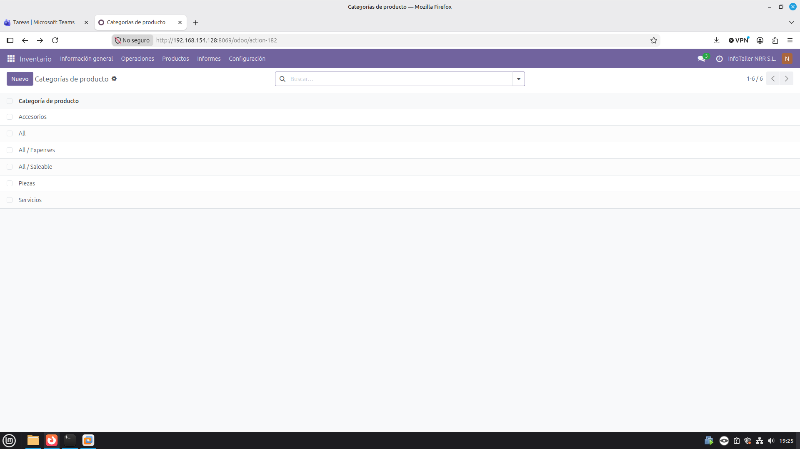
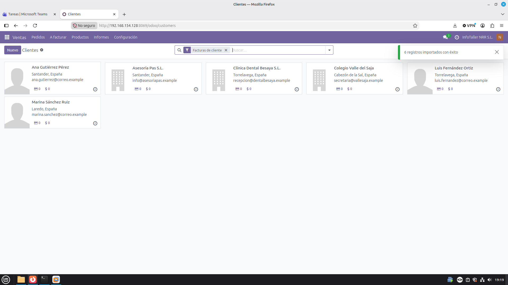
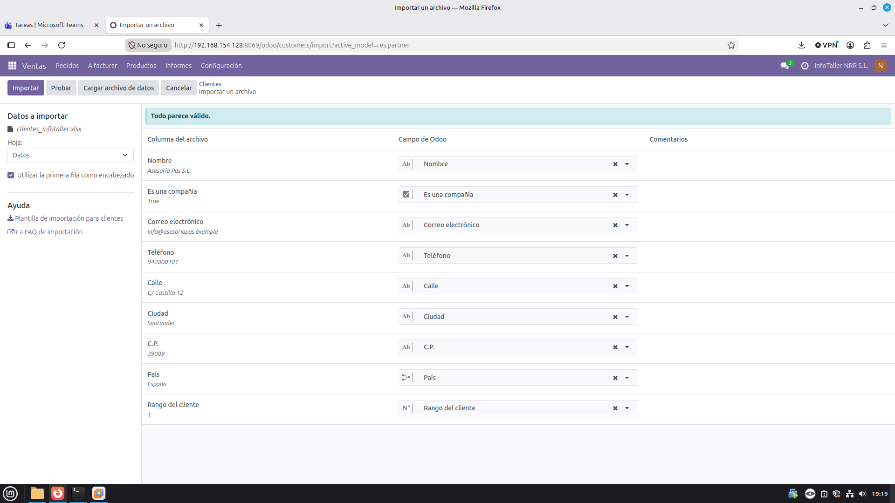
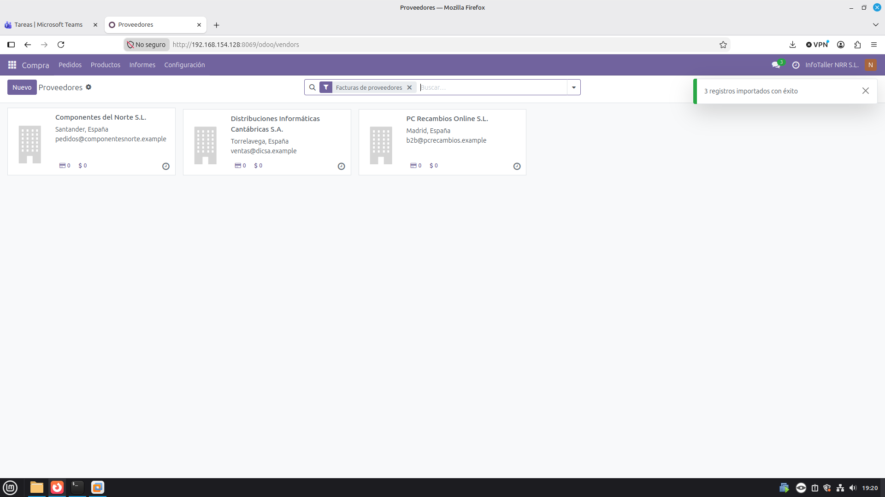
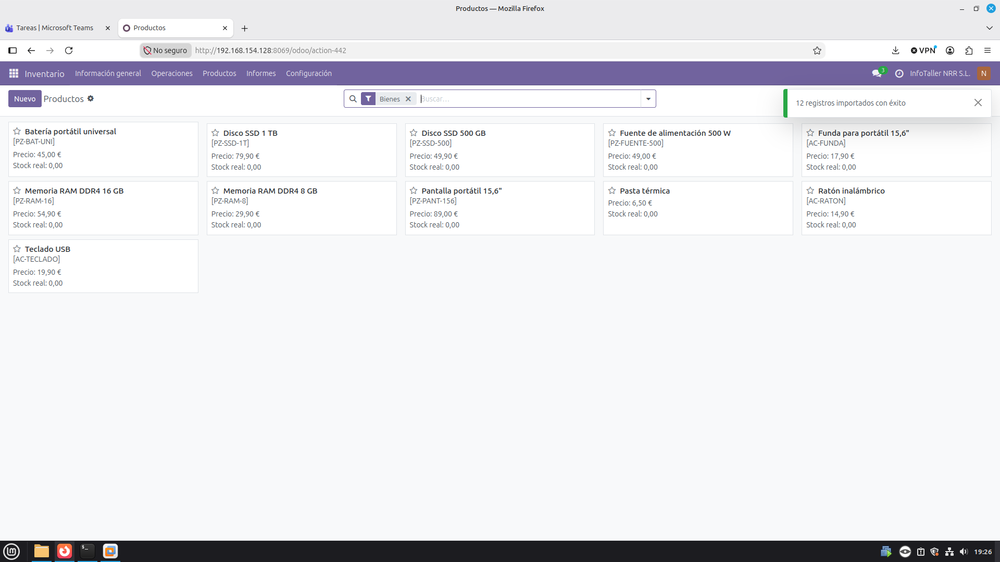
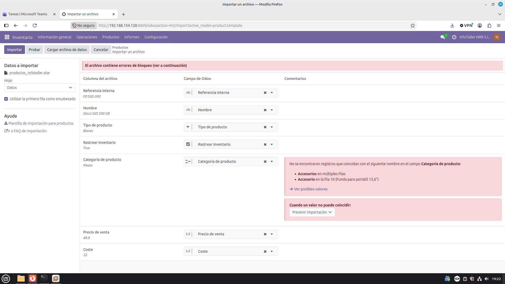
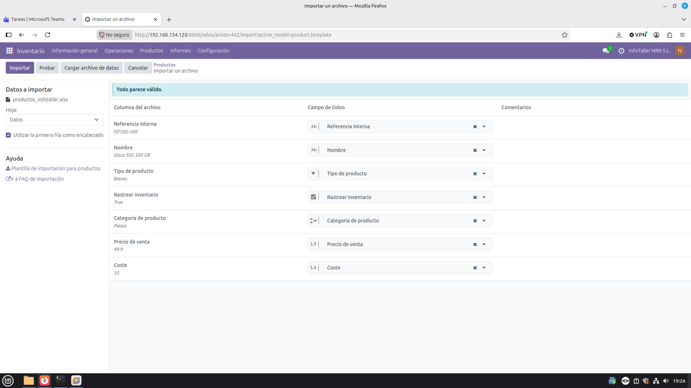
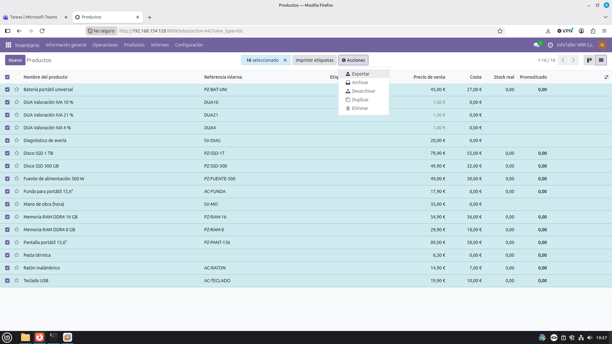
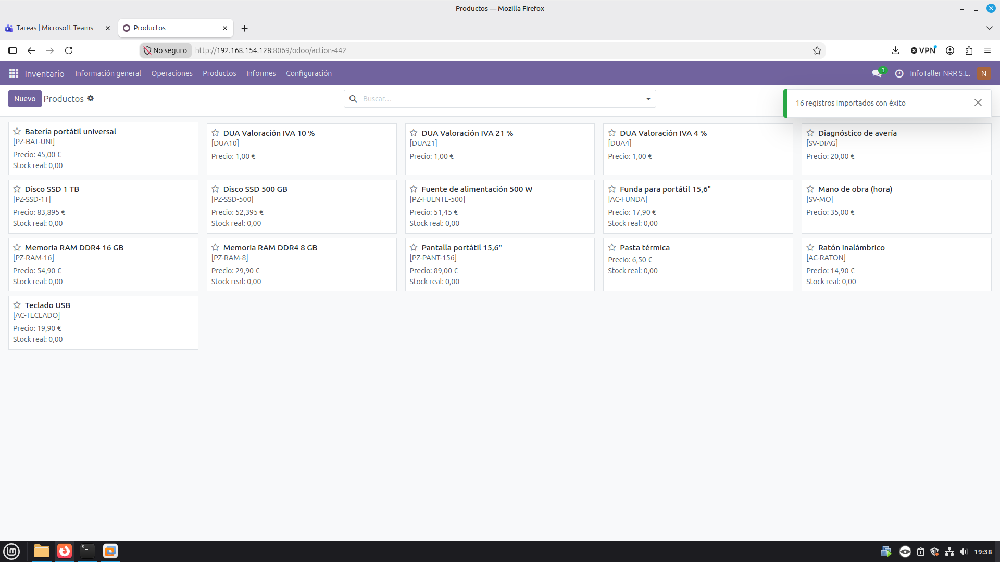

# UT3.3 – Cargamos los datos maestros

## Índice
- [1. Objetivo](#1-objetivo)
- [2. Categorías](#2-categorías)
- [3. Importación de contactos](#3-importación-de-contactos)
- [4. Importación de productos](#4-importación-de-productos)
- [5. Exportación compatible con importación](#5-exportación-compatible-con-importación)
- [6. Actualización masiva de precios](#6-actualización-masiva-de-precios)
- [7. Ampliación](#7-ampliación)
- [8. Incidencias](#8-incidencias)
- [9. Conclusiones](#9-conclusiones)

## 1. Objetivo

Importar contactos y productos a Odoo desde hojas de cálculo, comprobar y corregir errores de importación, exportar productos en un formato compatible con la importación y modificar masivamente los precios de venta de las piezas.

La actividad se realiza con Marta, usando una sesión privada, en la base de datos de InfoTaller.

## 2. Categorías

En Inventario → Configuración → Categorías de producto se crean tres categorías sin categoría padre:

- Piezas
- Accesorios
- Servicios

## 3. Importación de contactos

Se importan los ficheros proporcionados desde las listas correspondientes:

- `clientes_infotaller.xlsx`: Ventas → Pedidos → Clientes.
- `proveedores_infotaller.xlsx`: Compra → Pedidos → Proveedores.

En la ventana de importación se revisa la correspondencia de columnas y se utiliza **Probar** antes de ejecutar la importación.

Se comprueba que aparecen los seis clientes y los tres proveedores. El campo Rango de los archivos indica el rango o clasificación del contacto según los datos de origen; debe interpretarse con los valores que aparecen en las hojas suministradas.

Los contactos importados toman el idioma del usuario que realiza la importación. Por eso se comprueba que Clínica Dental Besaya S.L. tenga Spanish / Español como idioma, ya que este idioma se usa en los documentos que se generan para el contacto.

## 4. Importación de productos

Se importa `productos_infotaller.xlsx` desde Inventario → Productos → Productos. Se revisa el mapeo y se pulsa **Probar** antes de importar.

El fichero contiene un error intencionado. Se identifica mediante el resultado de la prueba, se corrige en la hoja de cálculo y se vuelve a probar hasta que no aparezcan errores. La captura documenta el resultado de la comprobación; el detalle exacto del error debe describirse conforme al error observado durante la importación, sin inventar su contenido.

Se quita el filtro Bienes y se agrupa por categoría para comprobar las cantidades indicadas en el enunciado: 7 productos en Piezas, 3 en Accesorios y 2 en Servicios. Los otros grupos corresponden a los elementos preexistentes de la práctica y a productos de valoración de impuestos de la localización española. Los productos de tipo Bienes tienen activado el seguimiento de inventario.

## 5. Exportación compatible con importación

En la lista de productos se quitan los filtros, se seleccionan todos y se utiliza Acciones → Exportar. Se activa **Quiero actualizar datos (exportación compatible con importación)** y se seleccionan los campos:

- Referencia interna
- Nombre
- Categoría de producto
- Precio de venta
- Coste

La plantilla se guarda como **Productos InfoTaller** y se exporta en XLSX.

En el fichero exportado, Odoo incluye una columna `id` (identificador externo), que permite identificar el registro que se actualizará al reimportar. Las categorías pueden aparecer representadas mediante identificadores externos como `__export__.product_category_...`, que identifican la categoría vinculada y no son el nombre visible de la categoría. La columna `id` no se debe modificar.

## 6. Actualización masiva de precios

En la hoja exportada se incrementa un 5 % el precio de venta de los productos cuya referencia interna empieza por `PZ-`, utilizando una fórmula de hoja de cálculo. Las demás filas se pueden conservar sin cambios o retirar. Se guarda el fichero y se importa de nuevo desde la lista de productos.

La importación compatible actualiza los registros existentes gracias al identificador externo; por ello no crea productos duplicados. Se comprueba el precio de un producto antes y después de la actualización.

## 7. Ampliación

Para exportar clientes en CSV se puede abrir el fichero con un editor de texto y observar el separador y la codificación utilizados. Al abrir un CSV directamente con Excel puede interpretarse incorrectamente el separador o la codificación, por ejemplo si los caracteres acentuados no se reconocen correctamente.

## 8. Incidencias

Las incidencias reales se recogen en [`incidencias.md`](incidencias.md). El error intencionado del fichero de productos debe describirse indicando qué campo o valor estaba mal, cómo lo detectó Odoo y qué modificación se hizo en la hoja.

## 9. Conclusiones

La importación permite cargar grandes cantidades de datos de forma rápida, pero es importante comprobar el mapeo y probar antes de importar. La exportación compatible con importación y los identificadores externos permiten realizar actualizaciones masivas sin duplicar registros.
