# UT3.4 – InfoTaller vende y compra

## Índice
- [1. Objetivo](#1-objetivo)
- [2. Stock inicial](#2-stock-inicial)
- [3. Circuito de venta](#3-circuito-de-venta)
- [4. Reabastecimiento](#4-reabastecimiento)
- [5. Circuito de compra](#5-circuito-de-compra)
- [6. Trazabilidad y documentos](#6-trazabilidad-y-documentos)
- [7. Ampliación](#7-ampliación)
- [8. Incidencias](#8-incidencias)
- [9. Conclusiones](#9-conclusiones)

## 1. Objetivo

Completar los circuitos de venta y compra de InfoTaller, identificar los estados de los documentos, diferenciar stock real y pronosticado, configurar una regla de reabastecimiento y comprobar la trazabilidad entre pedidos, entregas, facturas y movimientos de inventario.

Se trabaja con Marta en la base de datos de InfoTaller. Antes de comenzar se comprueba que el almacén se llama InfoTaller y que su abreviatura es WH.

## 2. Stock inicial

Se actualizan las cantidades de los productos desde sus fichas:

| Producto | Cantidad inicial |
|---|---:|
| Disco SSD 500 GB | 4 |
| Memoria RAM DDR4 16 GB | 10 |

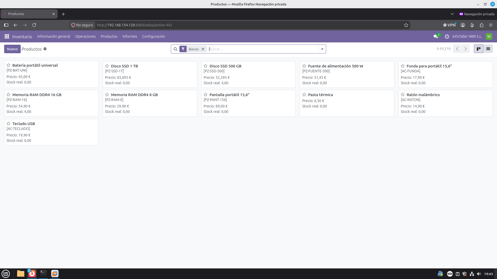
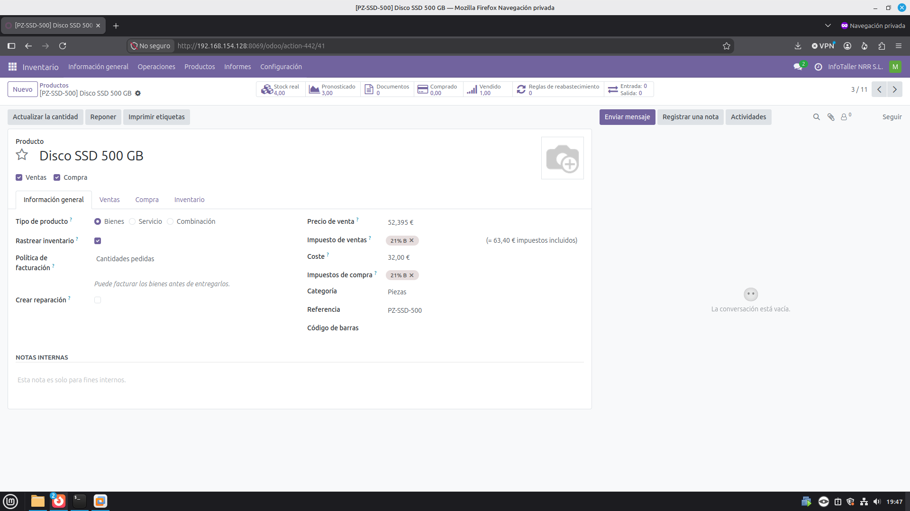
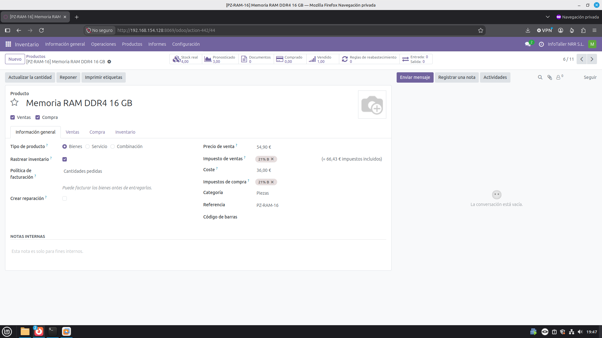

## 3. Circuito de venta

Se crea un presupuesto para Clínica Dental Besaya S.L. con una unidad de cada producto/servicio:

- Disco SSD 500 GB
- Memoria RAM DDR4 16 GB
- Mano de obra (hora)

Se guarda e imprime el presupuesto en PDF. Después se confirma el pedido y se consulta el stock del SSD. El stock real sigue siendo 4, mientras que el pronosticado baja a 3 porque la confirmación reserva la unidad para la entrega, sin que se haya producido todavía la salida física.

Se abre la entrega desde el botón inteligente, se valida y se comprueba que queda en estado Hecho, con el pedido como documento de origen. Tras validar, el stock real del SSD pasa a 3.

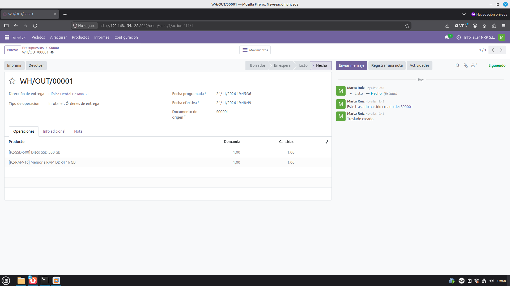
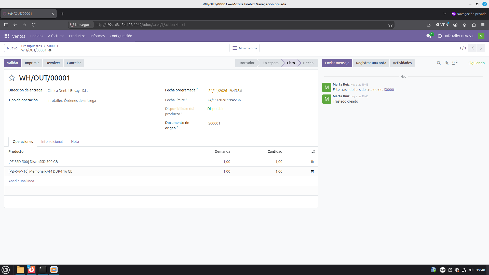

Se crea la factura desde el pedido, se confirma y se registra el pago. La factura queda publicada y pagada, y su botón inteligente Pedidos de venta permite volver al pedido relacionado.

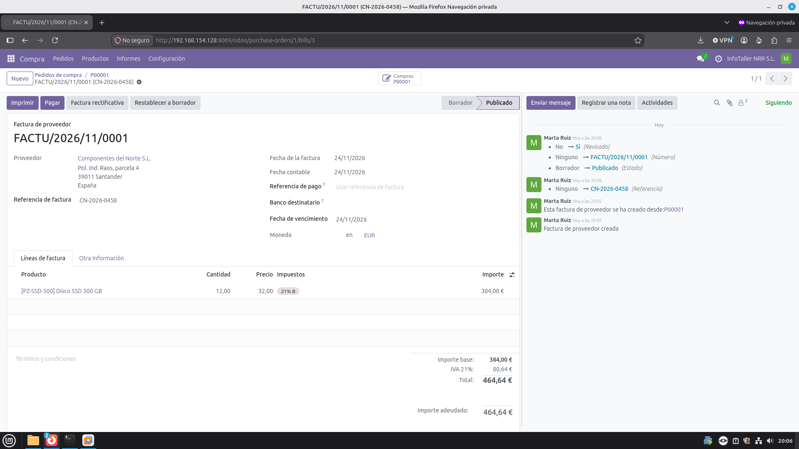

Los documentos PDF entregados en la carpeta `img/` son:

- [`Presupuesto - S00001.pdf`](img/Presupuesto%20-%20S00001.pdf)
- [`INV_2026_00001.pdf`](img/INV_2026_00001.pdf)

## 4. Reabastecimiento

En la ficha del Disco SSD 500 GB se añade el proveedor **Componentes del Norte** con precio 32,00 € y se comprueba que la ruta Comprar está activa.

Se crea una regla de reabastecimiento con mínimo 5 y máximo 15 unidades. La regla inicialmente es manual: Odoo calcula la necesidad, pero no crea automáticamente una compra hasta que se automatiza.

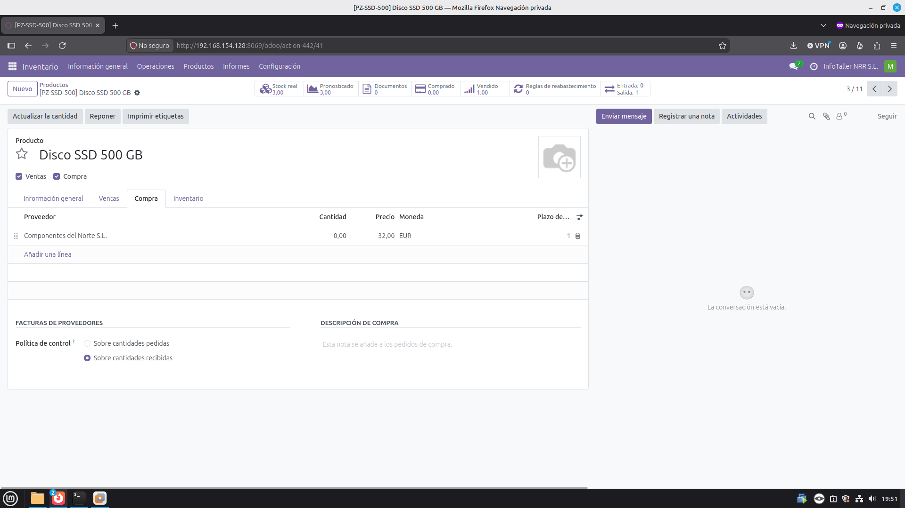
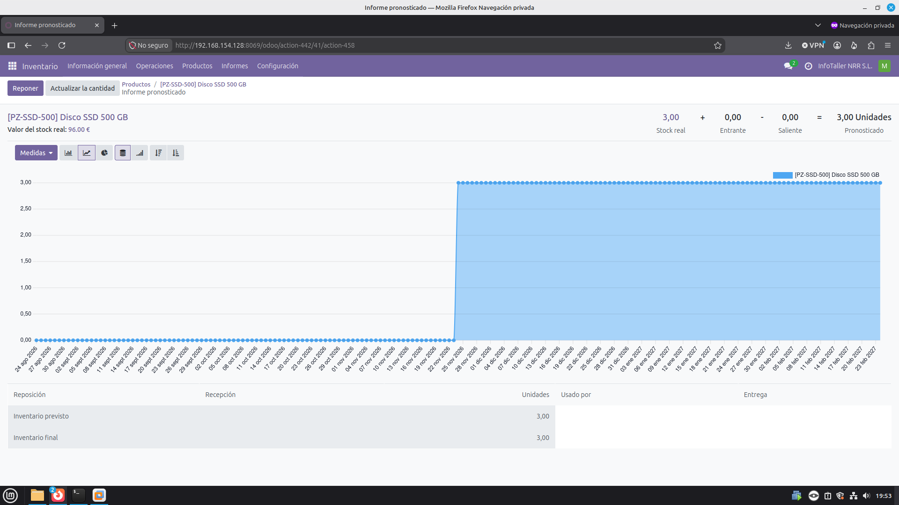
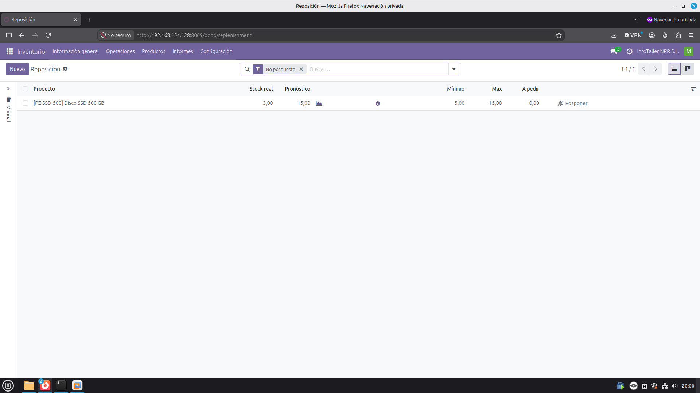

La captura de reposición debe realizarse antes de automatizar la regla, ya que al automatizar se genera la compra pendiente y el producto deja de aparecer en la lista de reposición si ya no necesita reponerse.

Al automatizar, Odoo crea una solicitud de presupuesto para 12 SSD. La cantidad corresponde a la diferencia necesaria para alcanzar el máximo de 15 cuando el pronóstico está en 3: `15 − 3 = 12`. La solicitud no se generó al confirmar la venta porque en ese momento la regla aún era manual.

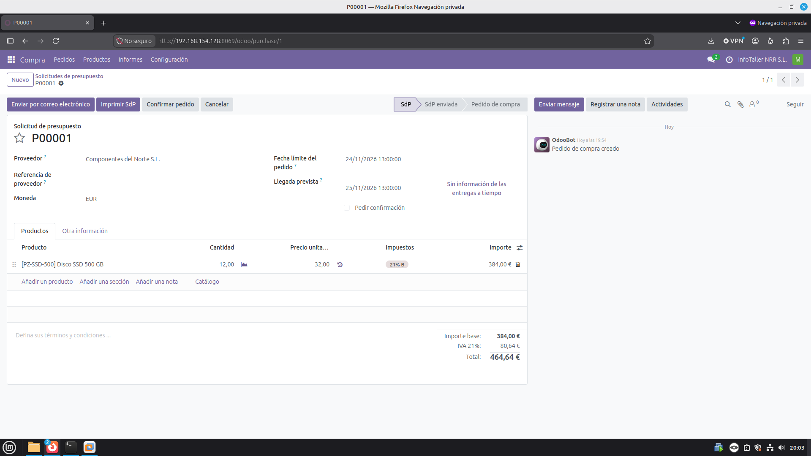
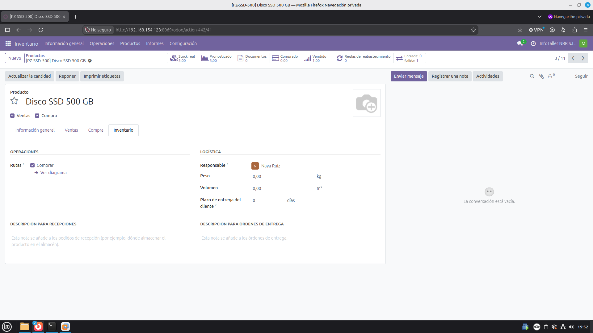

## 5. Circuito de compra

Se abre la solicitud de presupuesto generada para Componentes del Norte y se confirma. A continuación se abre la recepción desde el botón inteligente y se valida.

Después, desde el pedido de compra, se crea la factura de proveedor, se indica la fecha y una referencia de factura del proveedor, se confirma y se comprueba que queda publicada. No se registra el pago al proveedor: la empresa mantiene el importe pendiente de pago.

## 6. Trazabilidad y documentos

Se consulta Inventario → Informes → Historial de movimientos y se busca el Disco SSD 500 GB. El historial esperado contiene:

| Movimiento | Cantidad | Origen | Destino |
|---|---:|---|---|
| Stock inicial | +4 | Virtual Locations / Inventory adjustment | WH/Stock |
| Entrega de venta | −1 | WH/Stock | Partners / Customers |
| Recepción de compra | +12 | Partners / Vendors | WH/Stock |

Tras la recepción, el stock real es 15, el máximo establecido en la regla. Las ubicaciones de Clientes, Proveedores y Ajustes de inventario son ubicaciones virtuales que Odoo utiliza para identificar el origen o destino de las operaciones; no son almacenes físicos.

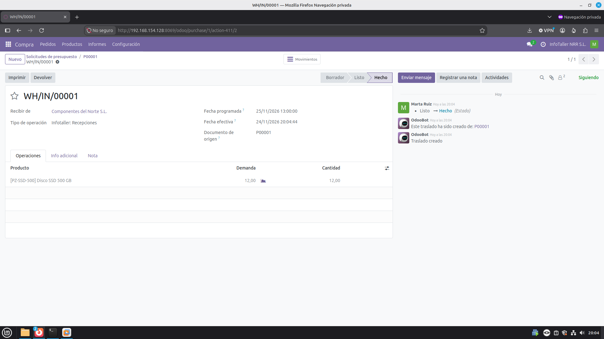
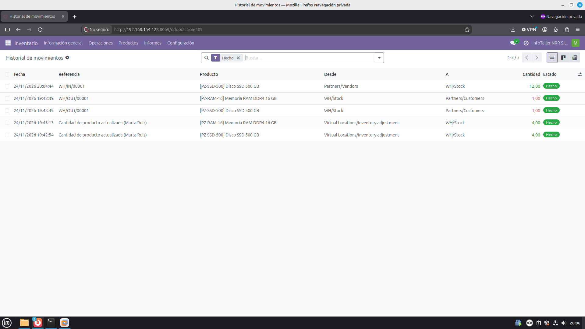

### Tabla de documentos

Completa las referencias exactas de los documentos de tu base de datos a partir de las capturas o PDF. No se inventan números de pedido o compra.

| Documento | Referencia | Estado final | Documento de origen |
|---|---|---|---|
| Presupuesto de venta | S00001 (según PDF adjunto) | Confirmado como pedido | — |
| Entrega | Consultar documento | Hecho | Pedido de venta |
| Factura de cliente | Consultar PDF/captura | Publicado y pagado | Pedido de venta |
| Solicitud de presupuesto de compra | Consultar documento | Confirmada como pedido de compra | Regla de reabastecimiento (OP/…) |
| Recepción | Consultar documento | Hecho | Pedido de compra |
| Factura de proveedor | Consultar documento | Publicado, pendiente de pago | Pedido de compra |

## 7. Ampliación

### Permisos de Javier

La prueba debe realizarse con otro presupuesto y un cliente distinto. Javier tiene permisos de Ventas: Usuario (todos los documentos), por lo que puede trabajar con presupuestos y pedidos de venta. Su acceso a las demás aplicaciones depende de los grupos asignados en la Actividad1. Registra qué acciones permite o bloquea la instalación real.

### CRM

En una base de datos de pruebas se puede instalar CRM, crear una oportunidad, planificar una llamada, moverla a Ganado y generar un presupuesto. CRM encaja antes del presupuesto, durante la captación y seguimiento de una posible venta; permite gestionar la oportunidad comercial antes de que se convierta en pedido.

## 8. Incidencias

Las incidencias reales se anotan en [`incidencias.md`](incidencias.md), con síntoma, causa y solución.

## 9. Conclusiones

El circuito de venta reserva existencias al confirmar el pedido y reduce el stock real al validar la entrega. El circuito de compra repone el inventario y permite seguir los documentos enlazados. Las reglas de reabastecimiento automatizan la compra cuando el pronóstico cae por debajo del mínimo y calculan la cantidad necesaria para alcanzar el máximo.
